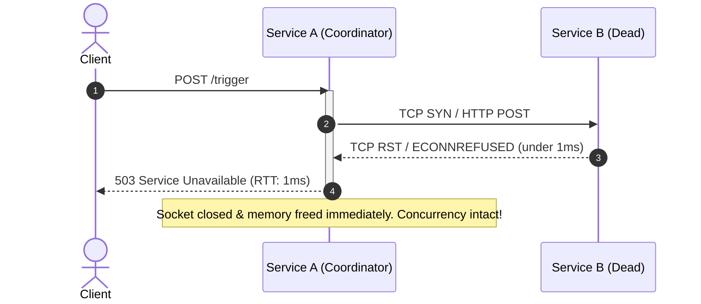
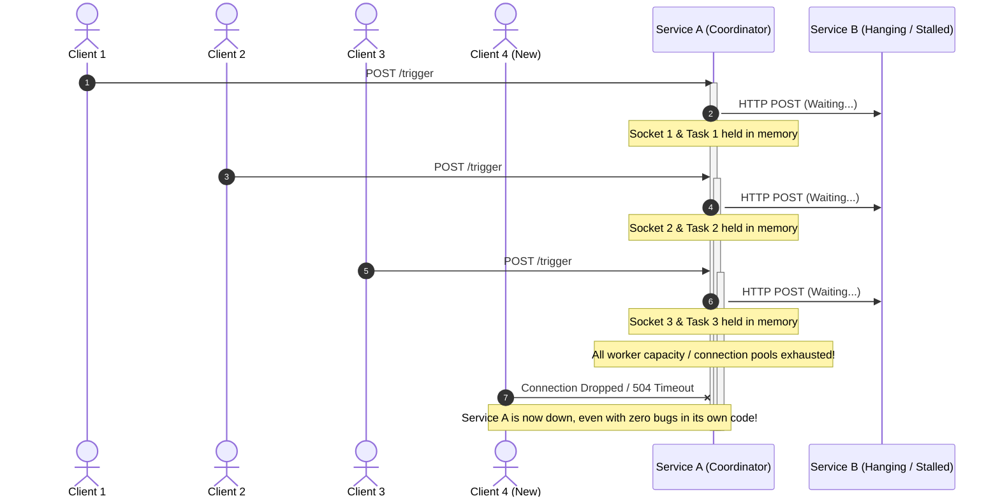
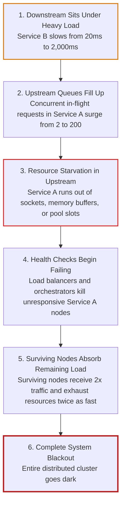

# Part 0: Distributed Failure Mechanics

Before diving into code and resilience patterns, we must understand **why distributed systems fail differently than monolithic applications**.

---

## 1. The Fallacies of Distributed Computing

In 1994, L. Peter Deutsch and James Gosling at Sun Microsystems formulated the **Eight Fallacies of Distributed Computing**. In monolithic applications running on a single machine, memory access is near-instantaneous and reliable. When developers move to microservices, they frequently write code as if network calls are as dependable as in-memory function calls.

The core fallacies relevant to our sandbox are:

1. **The network is reliable:** Packets drop, routers reboot, cables get cut, and wireless interfaces experience interference.
2. **Latency is zero:** In-memory calls take nanoseconds ($10^{-9}$s); network calls take milliseconds ($10^{-3}$s)—a difference of **six orders of magnitude** (1,000,000× slower).
3. **Bandwidth is infinite:** Network pipes saturate during traffic spikes.
4. **The network is homogeneous:** Different nodes, virtual switches, and network cards have varying capacities and latency profiles.
5. **Transport cost is zero:** Serializing, parsing JSON, TLS handshakes, and socket management consume measurable CPU cycles.

---

## 2. Why "Slow is Worse Than Dead"

A common intuition among software engineers is that an outright crash (HTTP 500 or Connection Refused) is the worst thing that can happen.

**In distributed systems, an extremely slow service is far more dangerous than a dead service.**

Here is why:

### Case A: Downstream Service B is DEAD (Immediate Fast-Fail)

* Service B immediately sends back a TCP `RST` packet or Service A gets an instant `ECONNREFUSED`.
* Service A's thread/task is occupied for **less than 1 millisecond**.
* Memory is freed, the socket is released, and Service A remains fully capable of serving other clients.

### Case B: Downstream Service B is SLOW (The Silent Killer)

* Service B accepts the TCP connection, but stalls (e.g. database lock, long Garbage Collection pause, CPU spike).
* Every request to Service A holds an open socket, an allocated memory buffer, and an active worker task.
* In seconds, Service A hits its concurrency limit. **Now Service A is dead too, even though Service A has zero bugs in its own code.**

---

## 3. The Cascading Failure Death Spiral

A **Cascading Failure** occurs when a fault in one low-level service propagates upstream, causing successive failures in caller services until the entire platform collapses.

---

## 4. Resource Starvation Mechanics

What exactly "runs out" when an upstream service waits on a slow downstream?

1. **OS File Descriptors (Sockets):**
   * In Linux, every TCP connection is represented as a file descriptor.
   * By default, OS processes have a `ulimit -n` cap (typically 1,024 or 65,535).
   * Once exceeded, the OS throws `OSError: [Errno 24] Too many open files`, blocking any new inbound client connections.

2. **Operating System TCP Buffers:**
   * Each open TCP connection allocates a kernel receive buffer (`rmem`) and send buffer (`wmem`) (typically 16KB to 128KB each).
   * 10,000 hanging connections can consume hundreds of megabytes of non-swappable kernel memory.

3. **HTTP Client Connection Pool Limits:**
   * HTTP clients like `httpx.AsyncClient` maintain a connection pool (e.g., `max_connections=100`).
   * When all 100 connections are waiting on slow responses from Service B, any 101st request in Service A is queued internally inside Python waiting for a free socket, adding internal queue latency.

---

## 5. Summary & Key Takeaway

> **Golden Rule of Microservices:**  
> *Never trust downstream services to respond in a timely manner. Every network call across a process boundary must be bounded, monitored, and isolated.*

In Part 1, we learn the very first line of defense: **Strict Timeouts**.
