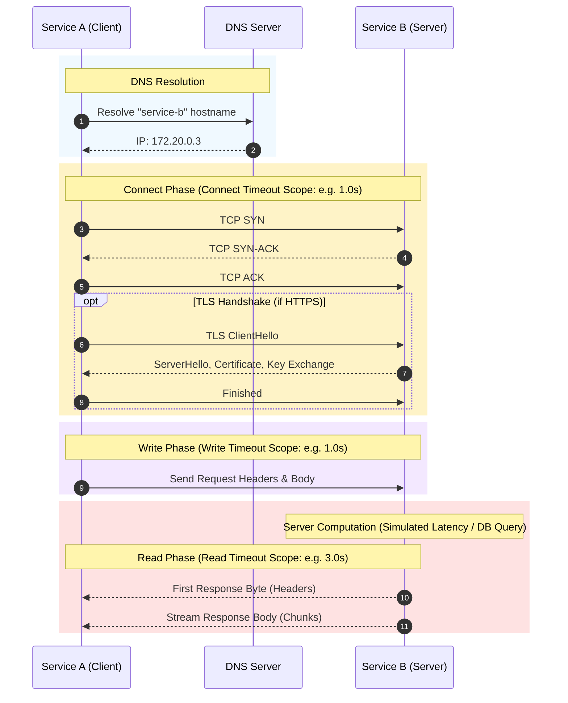
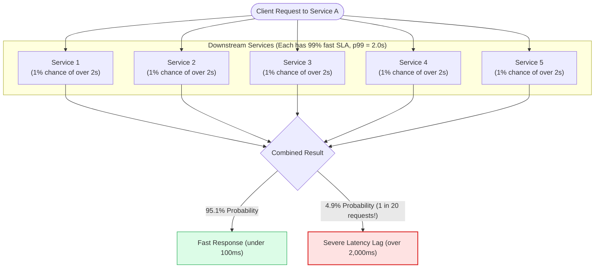
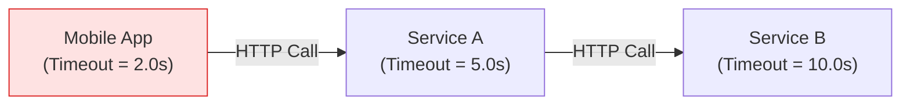

# Part 1: Strict Timeouts & Resource Protection

A **Timeout** is the maximum amount of time an upstream service is willing to wait for a network operation to complete before terminating the attempt and freeing its resources.

Timeouts are the most fundamental, non-negotiable resilience pattern in distributed architecture. **Without timeouts, a distributed system cannot guarantee availability.**

---

## 1. Anatomy of an HTTP Network Call

When Service A calls Service B over HTTP, the request does not happen in a single step. It undergoes distinct networking phases, each with its own failure characteristics:



### The 4 Distinct Timeout Types in `httpx`:

```python
import httpx

# Granular timeout configuration in httpx
timeout = httpx.Timeout(
    connect=1.0,  # Max time to complete TCP + TLS handshake (1s)
    read=3.0,     # Max time between bytes received from server (3s)
    write=1.0,    # Max time to send request data to network socket (1s)
    pool=2.0      # Max time to wait for a free connection from internal pool (2s)
)
```

1. **Connect Timeout:** How long Service A waits for Service B's OS to accept the TCP connection. If Service B is completely powered down or unreachable via network routing, this timer expires.
2. **Read Timeout:** How long Service A waits for Service B to calculate and return data after the connection is established. This is where slow database queries or simulated latency in Service B manifest.
3. **Write Timeout:** How long Service A waits to push the payload into the network socket. This triggers if the network upload pipe is saturated.
4. **Pool Timeout:** How long a request in Service A waits for another in-flight request to finish and return a connection back into the HTTP connection pool.

---

## 2. Tail Latency Amplification

Why does a small amount of latency in downstream services create catastrophic delays for end-users? This phenomenon is known as **Tail Latency Amplification**.

### The Math of Compounding Latency
Imagine Service A receives a request and must call **5 downstream microservices** in sequence (or in parallel) to assemble the response:



If each individual service has a 99th percentile ($p99$) latency of 2 seconds (meaning only 1 out of 100 requests takes > 2 seconds):

$$\text{Probability of all 5 responding fast} = (1 - 0.01)^5 = 0.99^5 \approx 0.951 \text{ (95.1\%)}$$

$$\text{Probability that AT LEAST ONE service stalls} = 1 - 0.951 = 0.049 \text{ (4.9\%)}$$

**Result:** Even though each service individually performs well 99% of the time, the aggregate system fails its SLA **almost 5% of the time (1 out of every 20 user requests hangs)**!

If your architecture has 20 microservices, the chance of at least one service hitting its $p99$ tail latency is:

$$1 - (0.99)^{20} = 1 - 0.817 = 18.3\%$$

Nearly **1 in 5 requests** will experience the maximum downstream tail latency unless strict timeouts cut them off!

---

## 3. How to Choose Timeout Thresholds

A common anti-pattern is picking arbitrary timeout numbers like `30s` or `60s`. 

### The SLA Budgeting Principle

Work backwards from your **User Experience Service Level Agreement (SLA)**:

```text
Total Client SLA Budget: 1,000ms
  │
  ├── Edge Gateway overhead:              50ms
  ├── Service A local computation:        50ms
  ├── Retries allowed (e.g., 2 attempts): 2 attempts
  │
  └── Downstream Timeout Budget:
      (1,000ms - 100ms) / 2 attempts = 450ms max per attempt!
```

### Empirical Percentile Rule of Thumb:
* Look at the historical latency of the downstream service during normal operation.
* Set the timeout to between the **$p99$ and $p99.9$** latency.
* *Example:* If Service B normal latency is $p50 = 25\text{ms}$, $p95 = 60\text{ms}$, and $p99 = 150\text{ms}$:
  * Setting timeout to `300ms` allows 99.9% of legitimate requests to complete while aborting the 0.1% pathological hangs before they exhaust connection pools.

---

## 4. Common Timeout Mistakes in Production

### Mistake 1: Leaving Default Timeouts (or `None`)
* In many programming libraries (e.g., standard Python `urllib` or older versions of `requests`), if you omit the `timeout` parameter, it defaults to **infinite wait (`None`)**.
* A single locked database table in a third-party vendor API will permanently hang your process until someone manually restarts the server.

### Mistake 2: Upstream Timeout Shorter Than Downstream Timeout


* If Service B takes 4 seconds, the Mobile App gives up after 2.0s and disconnects.
* But Service A continues waiting for 5.0s, and Service B continues crunching data for 10.0s.
* **You are spending expensive cloud compute and database CPU to calculate results that the client has already abandoned!**
* *Rule:* Downstream timeouts must always be strictly shorter than upstream caller timeouts.

### Mistake 3: Setting Only a "Global" Timeout Instead of Connect vs Read
* A network packet drop during TCP connection negotiation behaves very differently from a slow response query.
* A TCP connection handshake should usually succeed in under **1 second** (even cross-region). If it hasn't connected in 1s, the host is likely dead or the network route is down.
* The read timeout should reflect the expected workload execution time.

---

## 5. Summary & Checklist for Milestone 2

- [x] Enforce an explicit timeout on every HTTP call from Service A to Service B (`FR-2.1`).
- [x] Catch `httpx.TimeoutException` cleanly and translate it to an immediate `504 Gateway Timeout`.
- [x] Ensure resources (memory and sockets) are freed when a timeout triggers.
