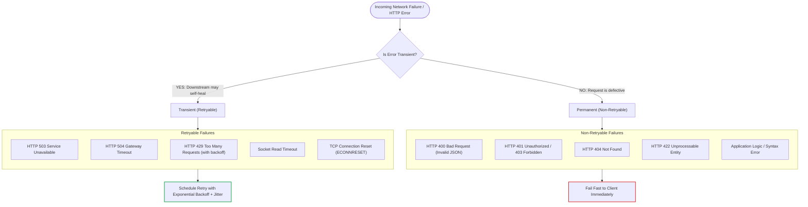
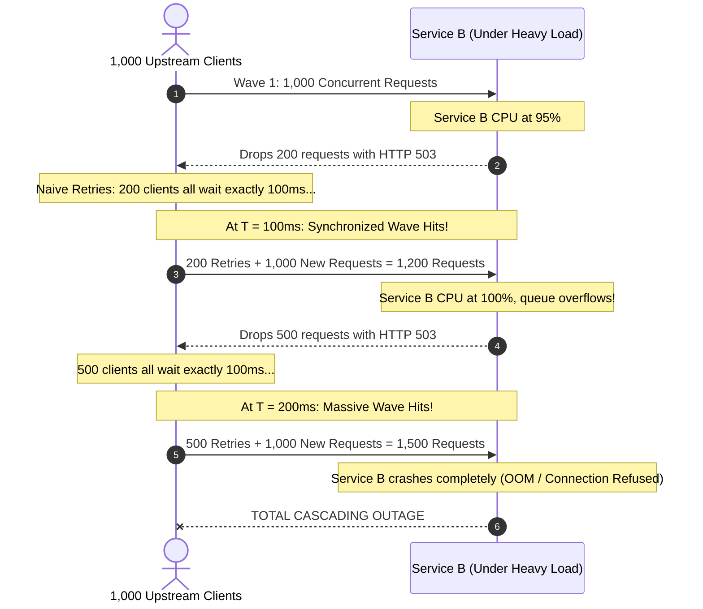
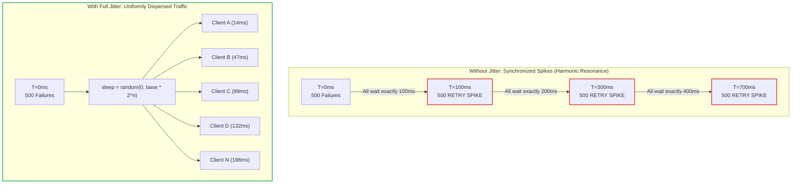
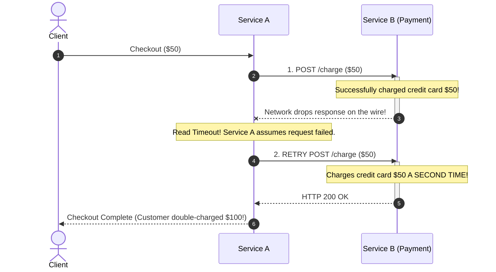

# Part 2: Retries, Exponential Backoff & Jitter

In a distributed network, many failures are **transient**—meaning they are temporary glitches that resolve themselves within a few milliseconds. A dropped packet, a router failover, or a brief server CPU spike can cause a single request to fail, but an immediate subsequent request might succeed perfectly.

The **Retry** pattern automatically re-attempts failed operations to increase overall system availability. However, **retries are a double-edged sword**: implemented improperly, they can effortlessly transform a minor blip into a catastrophic site-wide outage.

---

## 1. Transient vs. Permanent Errors: When to Retry

Never retry blindly. You must strictly distinguish between **transient (retryable)** and **permanent (non-retryable)** failures.



### The Rule:
* If the failure is caused by a **bad client request** (e.g. invalid JSON, missing authentication header, non-existent record), retrying 1,000 times will produce the exact same error 1,000 times, wasting CPU and bandwidth.
* Only retry errors where **the state of the downstream system may change over time**.

---

## 2. The Danger of Naive Retries: The "Retry Storm"

Consider a downstream service (Service B) that experiences a momentary traffic spike and begins dropping 20% of its requests:



This self-inflicted disaster is called a **Retry Storm** (or the **Thundering Herd Problem**). When clients retry with a fixed delay, their requests naturally synchronize into synchronized "pulses" or waves that overwhelm the backend.

---

## 3. Backoff Schedules: Giving the Server Room to Breathe

Instead of retrying immediately, clients must wait progressively longer between attempts.

### 1. Constant Delay (Anti-Pattern)
* Attempt 1: wait 100ms
* Attempt 2: wait 100ms
* Attempt 3: wait 100ms
* *Flaw:* Synchronizes retries into waves.

### 2. Linear Backoff
* Attempt 1: wait 100ms
* Attempt 2: wait 200ms
* Attempt 3: wait 300ms
* *Flaw:* Doesn't scale fast enough for deep system recovery.

### 3. Exponential Backoff
* Wait time grows exponentially with each attempt $n$:
  
  $$\text{Delay} = \min(\text{cap}, \text{base} \times 2^n)$$

* *Example with $\text{base} = 100\text{ms}, \text{cap} = 5000\text{ms}$:*
  * Attempt 0: $100\text{ms} \times 2^0 = 100\text{ms}$
  * Attempt 1: $100\text{ms} \times 2^1 = 200\text{ms}$
  * Attempt 2: $100\text{ms} \times 2^2 = 400\text{ms}$
  * Attempt 3: $100\text{ms} \times 2^3 = 800\text{ms}$
  * Attempt 4: $100\text{ms} \times 2^4 = 1600\text{ms}$

Exponential backoff rapidly gives an overwhelmed service the idle seconds it needs to flush queues and recover.

---

## 4. The Magic of Jitter: Breaking the Synchronization

Even with exponential backoff, if 500 clients all fail at timestamp $T=0$, they will **all retry together at $T=100\text{ms}$, and all retry together at $T=300\text{ms}$, and all retry together at $T=700\text{ms}$**.

To break this harmonic lockstep, we introduce **Jitter** (random noise).

### Visual Comparison of Traffic Waves



### The Three Jitter Algorithms (AWS Architecture Paper)

In 2015, AWS published the definitive research paper on jitter algorithms (*"Exponential Backoff And Jitter"*, Marc Brooker). Here are the three primary formulas:

#### Algorithm 1: Full Jitter (Recommended for Microservices)
Picks a uniform random delay between 0 and the calculated exponential ceiling:

$$\text{sleep} = \text{random\_between}(0, \min(\text{cap}, \text{base} \times 2^{\text{attempt}}))$$

* **Why it wins:** It produces the lowest client wait time and the smoothest load distribution across the server timeline.

#### Algorithm 2: Equal Jitter
Guarantees a minimum backoff plus a randomized portion:

$$\text{temp} = \min(\text{cap}, \text{base} \times 2^{\text{attempt}})$$
$$\text{sleep} = \frac{\text{temp}}{2} + \text{random\_between}\left(0, \frac{\text{temp}}{2}\right)$$

#### Algorithm 3: Decorrelated Jitter
Increases the backoff based on the *previous* sleep duration:

$$\text{sleep} = \min(\text{cap}, \text{random\_between}(\text{base}, \text{sleep}_{\text{prev}} \times 3))$$

---

## 5. Python Implementation Example

Here is what Full Jitter looks like in modern async Python:

```python
import asyncio
import random

async def retry_with_backoff(
    coroutine_func,
    max_retries: int = 3,
    base_delay_ms: float = 100.0,
    max_delay_ms: float = 2000.0,
):
    for attempt in range(max_retries + 1):
        try:
            return await coroutine_func()
        except (httpx.TimeoutException, httpx.ConnectError) as exc:
            if attempt == max_retries:
                # Exhausted all attempts
                raise exc
            
            # Calculate exponential backoff ceiling
            exp_delay = min(max_delay_ms, base_delay_ms * (2 ** attempt))
            
            # Apply Full Jitter: random float between 0 and exp_delay
            sleep_time_ms = random.uniform(0, exp_delay)
            
            await asyncio.sleep(sleep_time_ms / 1000.0)
```

---

## 6. The Idempotency Warning: The Greatest Trap of Retries

> **CRITICAL ARCHITECTURAL WARNING:**  
> **Never retry a non-idempotent operation without an idempotency key.**

### What is an Idempotent Operation?
An operation is **idempotent** if performing it multiple times with the same parameters produces the exact same outcome as performing it once:
* $f(x) = f(f(x))$
* In HTTP: `GET`, `PUT`, `DELETE`, and `HEAD` are typically idempotent by specification.
* In HTTP: `POST` is **NOT idempotent** by default (e.g. creates a new order, charges a card, appends a record).

### What Happens When You Blindly Retry a POST?



### The Solution:
Propagate a unique **`Idempotency-Key`** or **`Request-ID`** in headers. Downstream records the key; if it receives the same key twice, it skips execution and returns the cached result. (We will implement this directly in Milestone 3).

---

## 7. Common Retry Mistakes in Production

1. **Retry Multiplication (The Cascade Multiplier):**
   * If Service A calls Service B with 3 retries, and Service B calls Service C with 3 retries:
   * A single user request can trigger $1 \times 3 \times 3 = 9$ calls to Service C!
   * In a 4-tier microservice architecture, $3^4 = 81$ calls hit the database for 1 user click.
   * *Rule:* Only retry at one architectural layer (usually at the edge or ingress coordinator).

2. **No Maximum Retry Cap:**
   * Loops like `while True: retry()` will freeze processes and pin CPU threads indefinitely.
   * Standard practice is a strict maximum of **2 or 3 retries**.

3. **Retries with Equal or Zero Delay:**
   * Retrying immediately without backoff guarantees that an already struggling server remains crushed.

---

## 8. Summary & Checklist for Milestone 2

- [x] Classify failures: Retry timeouts and 503/504 errors; do not retry 4xx errors.
- [x] Implement Exponential Backoff with **Full Jitter** (`FR-2.2`).
- [x] Limit total retries to a safe ceiling (e.g., maximum 3 attempts).
- [x] Always pass the unique `request_id` downstream on every retry attempt.
