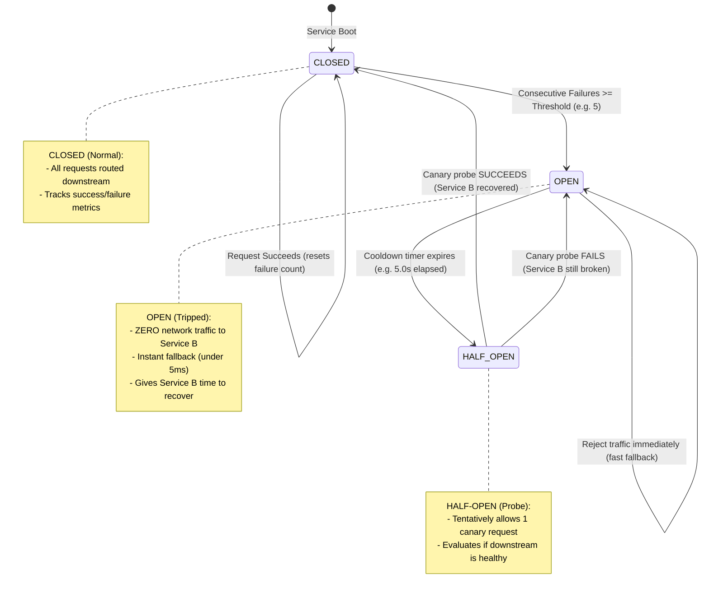

# Part 3: The Circuit Breaker Pattern

In an electrical panel at your house, a **circuit breaker** is a switch designed to protect an electrical circuit from damage caused by an overload or short circuit. If the current spikes to dangerous levels, the breaker trips to **OPEN**, immediately severing the flow of electricity to prevent your house from catching fire.

In software architecture (popularized by Michael Nygard in his seminal book *Release It!*), the **Circuit Breaker** pattern serves the exact same role.

When a downstream service is experiencing an outage or severe degradation, continuing to send it thousands of requests guarantees two things:
1. The downstream service can **never recover** because it is continuously bombarded with incoming requests.
2. The calling service **wastes resources** (threads, memory, time) waiting on calls that are guaranteed to fail.

The Circuit Breaker wraps network calls and automatically **cuts off network traffic** to downstream when failure rates exceed a threshold, failing immediately with a fast fallback response.

---

## 1. The 3-State Finite State Machine (FSM)

The Circuit Breaker operates as a state machine with three distinct states:



---

## 2. Deep Dive into the States

### State 1: `CLOSED` (Normal Operation)
* **Behavior:** Every request is allowed to execute against downstream Service B.
* **Monitoring:** The breaker monitors the outcome of every request (Success vs Failure).
* **Failure Accounting:** Failures are tracked either as:
  * **Consecutive Failures:** e.g., 5 failures in a row.
  * **Rolling Time Window:** e.g., $>50\%$ failures over the last 10 seconds (with a minimum request threshold of at least 10 requests).
* **Transition Trigger:** If the failure threshold is crossed, the breaker immediately trips to **`OPEN`** and records the current timestamp `last_state_change`.

---

### State 2: `OPEN` (Tripped / Short-Circuited)
* **Behavior:** **Zero network calls are made to Service B.**
* **Speed:** Calls fail immediately in **$<5\text{ms}$** (satisfying PRD acceptance criteria).
* **Result:** The breaker executes a **Fallback Strategy** (or returns a standardized degraded error).
* **Benefits:**
  1. Service A's response time drops from seconds to under 5ms, preserving its thread pool and memory.
  2. Service B receives zero traffic from Service A, giving it room to restart, finish garbage collection, or drain backlogs.
* **Transition Trigger:** The breaker stays `OPEN` until a **Cooldown Timeout** (e.g., `5.0 seconds`) has elapsed. Once the cooldown passes, the next incoming request transitions the breaker to **`HALF-OPEN`**.

---

### State 3: `HALF-OPEN` (Canary / Probe Mode)
* **Behavior:** The breaker tentatively allows **one probe request** (a "canary") to attempt a real network call to Service B.
* **Evaluation:**
  * **If the probe succeeds:** The breaker assumes Service B has healed. It transitions back to **`CLOSED`**, resets the failure counters, and normal traffic resumes.
  * **If the probe fails:** The breaker assumes Service B is still broken. It immediately re-trips back to **`OPEN`** and starts a fresh cooldown timer.

---

## 3. Fallback Strategies: What to Do When the Circuit is OPEN

When a circuit trips, your application must decide how to handle the customer. Common fallback strategies include:

| Fallback Strategy | How It Works | Example Use Case |
| :--- | :--- | :--- |
| **Silent Degradation (Default Value)** | Return an empty list or neutral value. | Product recommendation service is down $\rightarrow$ return empty list; the main product page still renders. |
| **Stale Cache Fallback** | Return previously cached data from Redis/memory even if expired. | Currency conversion rates $\rightarrow$ return 1-hour-old exchange rate rather than failing checkout. |
| **Graceful Degradation** | Return a user-friendly degraded acknowledgment. | Order Service queues order to local disk/broker with status `"Received, processing in background"`. |
| **Fast Error (503 Service Unavailable)** | Return an immediate HTTP 503 with a `Retry-After: 5` header. | Strict transactional operations where guessing or caching is unacceptable. |

---

## 4. Circuit Breaker vs. Rate Limiter vs. Bulkhead

Beginners often confuse these three patterns:

| Pattern | Primary Question / Purpose | Failure Mode Addressed |
| :--- | :--- | :--- |
| **Circuit Breaker** | "Is the DOWNSTREAM service healthy?" | Cuts traffic to prevent cascading failure from broken dependencies. |
| **Rate Limiter** | "Is the UPSTREAM client sending too much traffic?" | Caps requests per second to protect self from traffic spikes. |
| **Bulkhead** | "How do we isolate failure inside our own service?" | Partitions thread/connection pools so one slow endpoint doesn't starve others. |

---

## 5. Thread Safety & Async Safety in Python

In FastAPI, multiple concurrent async tasks will access the Circuit Breaker at the exact same time.

To prevent race conditions when multiple tasks read or change states simultaneously:
* In standard multi-threaded Python, a `threading.Lock` is used.
* In `asyncio` Python (like FastAPI), an **`asyncio.Lock`** is required when modifying breaker state to guarantee atomic state transitions without blocking the async event loop:

```python
import asyncio
import time
from enum import Enum

class BreakerState(str, Enum):
    CLOSED = "CLOSED"
    OPEN = "OPEN"
    HALF_OPEN = "HALF_OPEN"

class CircuitBreaker:
    def __init__(self, failure_threshold: int = 5, recovery_timeout: float = 5.0):
        self.state = BreakerState.CLOSED
        self.failure_threshold = failure_threshold
        self.recovery_timeout = recovery_timeout
        self.failure_count = 0
        self.last_state_change = time.monotonic()
        self._lock = asyncio.Lock()

    async def can_execute(self) -> bool:
        async with self._lock:
            now = time.monotonic()
            if self.state == BreakerState.OPEN:
                if (now - self.last_state_change) > self.recovery_timeout:
                    self.state = BreakerState.HALF_OPEN
                    self.last_state_change = now
                    return True
                return False  # Still in cooldown, fast-fail!
            return True
```

---

## 6. Common Circuit Breaker Mistakes in Production

1. **Tripping on Tiny Traffic Volumes:**
   * If failure threshold is set to "50% failures" and only 2 requests arrive, 1 failure is 50%.
   * *Fix:* Always require a **minimum request volume** (e.g. at least 10 requests) before computing percentage-based error rates.

2. **Sharing a Single Circuit Breaker Across Multiple Downstream Dependencies:**
   * If Service A calls Payment Service, Inventory Service, and Email Service:
   * **Each external service must have its own isolated Circuit Breaker instance.**
   * If Email goes down, you must not trip the breaker for Payment!

3. **Fallback That Calls Another Broken Dependency:**
   * If your fallback for a slow database query is calling a secondary database that is also overloaded, you trigger a second cascading failure. Fallbacks must be fast, local, and rock-solid.

4. **Missing Observability:**
   * When a circuit trips to `OPEN`, an alert must fire immediately to your monitoring dashboard (Datadog, Prometheus, Grafana). A silent circuit breaker leaves engineers unaware that users are receiving degraded experiences.

---

## 7. Summary & Checklist for Milestone 2

- [x] Implement the 3-State FSM (`CLOSED`, `OPEN`, `HALF-OPEN`) (`FR-2.3`).
- [x] Trip from `CLOSED` to `OPEN` when consecutive failures exceed threshold.
- [x] Return immediate degraded fallback response in $<50\text{ms}$ (usually $<5\text{ms}$) when `OPEN`.
- [x] Transition to `HALF-OPEN` after cooldown period and probe downstream.
- [x] Expose real-time breaker status via `GET /circuit-breaker` for observability.
