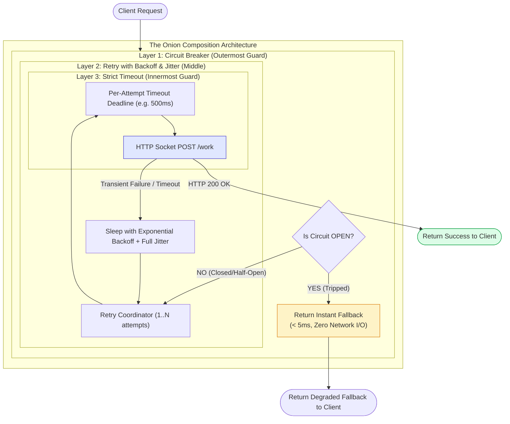
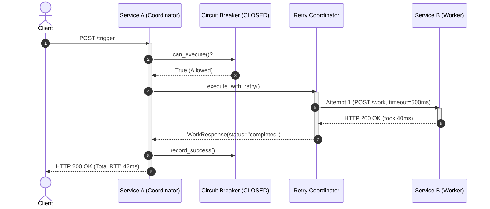
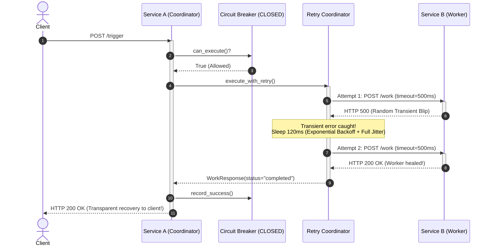
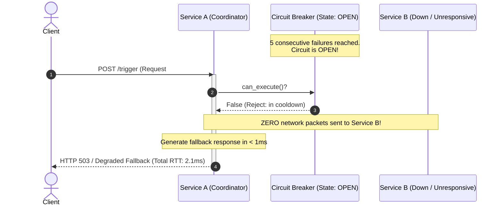
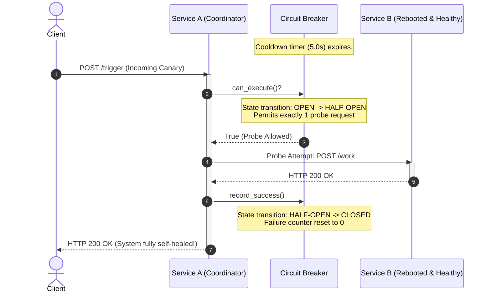

# Part 4: Pattern Composition & Request Lifecycle

Now that we have explored **Strict Timeouts**, **Retries with Jitter**, and **Circuit Breakers** individually, we must address the most critical architectural question:

> **How do these three patterns compose together, and in what exact order should they execute?**

Getting the nesting order wrong is one of the most common distributed systems mistakes.

---

## 1. The "Russian Doll" (Onion) Composition Model

The three patterns must wrap the downstream network call like concentric layers of an onion:



```text
 ┌────────────────────────────────────────────────────────────────────────┐
 │                      THE ONION COMPOSITION MODEL                       │
 └────────────────────────────────────────────────────────────────────────┘

    Client Request
          │
          ▼
   ┌────────────────────────────────────────────────────────┐
   │ 1. CIRCUIT BREAKER (Outer Guard)                       │
   │    Checks: "Is Service B healthy overall?"             │
   │    If OPEN: ABORT IMMEDIATELY (return fallback <5ms)   │
   │                                                        │
   │    ┌──────────────────────────────────────────────┐    │
   │    │ 2. RETRY + JITTER (Loop Coordinator)         │    │
   │    │    Coordinates attempts 1, 2, 3...           │    │
   │    │    Waits with randomized backoff if transient│    │
   │    │                                              │    │
   │    │    ┌────────────────────────────────────┐    │    │
   │    │    │ 3. STRICT TIMEOUT (Inner Deadline) │    │    │
   │    │    │    Enforces timeout PER ATTEMPT    │    │    │
   │    │    │                                    │    │    │
   │    │    │    ┌──────────────────────────┐    │    │    │
   │    │    │    │ 4. HTTP NETWORK SOCKET   │    │    │    │
   │    │    │    │    POST http://service-b │    │    │    │
   │    │    │    └──────────────────────────┘    │    │    │
   │    │    └────────────────────────────────────┘    │    │
   │    └──────────────────────────────────────────────┘    │
   └────────────────────────────────────────────────────────┘
```

---

## 2. Why the Order of Execution Matters

### Why Circuit Breaker Must Be on the OUTSIDE:
* If the Circuit Breaker is `OPEN`, **we want zero network calls and zero retry loops**.
* If you placed the Retry loop outside the Circuit Breaker:
  * The caller would retry an already-tripped circuit breaker 3 times in a row, wasting CPU and delaying the fallback response.
* **Rule:** Circuit Breaker acts as the outermost gatekeeper. If the gate is closed, nobody enters the retry loop.

### Why Timeout Must Be INSIDE Each Retry Attempt:
* A timeout must apply to **each individual HTTP attempt**, not across the entire retry lifecycle.
* *Example:* If you allow 3 attempts and set a per-attempt timeout of `500ms`:
  * Attempt 1 times out at 500ms $\rightarrow$ retry.
  * Attempt 2 times out at 500ms $\rightarrow$ retry.
  * Attempt 3 succeeds in 120ms $\rightarrow$ success!
* If you placed a single global timeout outside the retry loop, a slow first attempt would consume the entire time budget, leaving zero time for retries.

---

## 3. The 4 Operational Scenarios (Sequence Diagrams)

### Scenario 1: The Happy Path (Downstream is Healthy)



```text
Client                Service A (CB: CLOSED)               Service B
  │                             │                              │
  ├─── POST /trigger ──────────►│                              │
  │                             ├─── [CB Check: CLOSED (OK)]   │
  │                             ├─── [Attempt 1: Timeout=500ms]│
  │                             ├─── POST /work ──────────────►│
  │                             │                              │ (Takes 40ms)
  │                             │◄── HTTP 200 OK ──────────────┤
  │                             ├─── [Record CB Success]       │
  │◄── HTTP 200 (Success) ──────┤                              │
```

---

### Scenario 2: Transient Blip (Recovered by Retry + Jitter)



```text
Client                Service A (CB: CLOSED)               Service B
  │                             │                              │
  ├─── POST /trigger ──────────►│                              │
  │                             ├─── [Attempt 1: Timeout=500ms]│
  │                             ├─── POST /work ──────────────►│
  │                             │◄── HTTP 500 (Random Blip!) ──┤
  │                             │                              │
  │                             ├─── [Wait 120ms Full Jitter]  │
  │                             │                              │
  │                             ├─── [Attempt 2: Timeout=500ms]│
  │                             ├─── POST /work ──────────────►│
  │                             │◄── HTTP 200 OK (Recovered!) ─┤
  │                             ├─── [Record CB Success]       │
  │◄── HTTP 200 (Success) ──────┤                              │
```
* The client **never sees the error**. Availability is preserved seamlessly.

---

### Scenario 3: Sustained Outage (Breaker Trips $\rightarrow$ Fast Fallback)



```text
Client                Service A                            Service B (DOWN)
  │                             │                                  │
  │ [Requests 1 to 5 fail...]   │                                  │
  │                             ├─── [5 Consecutive Failures!]     │
  │                             ├─── [TRIP STATE: CLOSED -> OPEN]  │
  │                             │                                  │
  │ [Request 6 Arrives]         │                                  │
  ├─── POST /trigger ──────────►│                                  │
  │                             ├─── [CB Check: OPEN!]             │
  │                             ├─── [SKIP NETWORK ENTIRELY]       │
  │                             ├─── [Generate Fallback in 1ms]    │
  │◄── HTTP 200/503 (Fallback) ─┤                                  │
       (Took <3ms total!)
```
* **Acceptance Criteria Verified:** Service A responds in $<5\text{ms}$ with zero network load sent to Service B.

---

### Scenario 4: Self-Healing Recovery (HALF-OPEN Probe)



```text
Client                Service A (CB: OPEN)                 Service B (REBOOTED)
  │                             │                                  │
  │ [Cooldown 5.0s Passes...]   │                                  │
  │                             │                                  │
  │ [Incoming Probe Request]    │                                  │
  ├─── POST /trigger ──────────►│                                  │
  │                             ├─── [Cooldown Expired!]           │
  │                             ├─── [STATE: OPEN -> HALF-OPEN]    │
  │                             │                                  │
  │                             ├─── [Dispatch 1 Canary Probe]     │
  │                             ├─── POST /work ──────────────────►│
  │                             │◄── HTTP 200 OK ──────────────────┤
  │                             │                                  │
  │                             ├─── [Canary Succeeded!]           │
  │                             ├─── [STATE: HALF-OPEN -> CLOSED]  │
  │                             ├─── [Reset Failure Counter = 0]   │
  │◄── HTTP 200 (Success) ──────┤                                  │
```
* Normal full-speed operations automatically resume without human intervention.

---

## 4. Code Structure for Milestone 2

To maintain clean separation of concerns, we will structure Service A as follows:

```text
services/service-a/app/
├── __init__.py
├── config.py                 # Timeouts, retry counts, CB thresholds
├── schemas.py                # Request/response validation schemas
├── main.py                   # FastAPI routing and lifespan
└── resilience/
    ├── __init__.py
    ├── circuit_breaker.py    # Thread/async-safe Circuit Breaker state machine
    └── retry.py              # Exponential backoff with Full Jitter implementation
```

---

## 5. Summary Cheatsheet for System Design

| Concern | Pattern | Key Metric to Watch |
| :--- | :--- | :--- |
| **Hanging connections** | Strict Timeouts | Downstream $p99$ response time |
| **Transient blips** | Retry with Jitter | Retry rate vs total request rate ($<5\%$) |
| **Cascading outages** | Circuit Breaker | Breaker state transitions (`CLOSED` $\rightarrow$ `OPEN`) |
| **Recovery time** | Half-Open Probe | Recovery Time Objective (RTO in seconds) |

---

*This concludes the Milestone 2 learning documents. We are ready to implement the resilience engine!*
