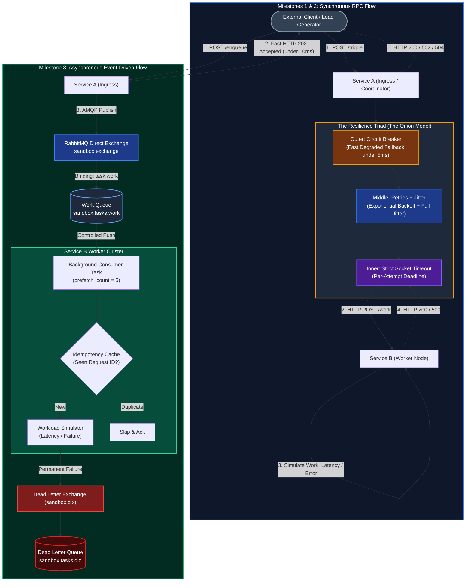

# System Architecture & Component Overview

Welcome back! This document serves as a complete architectural reference for the **Zero-Logic Microservices Architecture Sandbox**. It summarizes the design philosophy, system components, communication topologies, resilience patterns, and current project milestones in one place.

---

## 1. Executive Summary & Core Philosophy

### Why "Zero-Logic"?
In traditional tutorials, learning microservices often gets bogged down in domain-specific business logic: building user auth, writing database CRUD migrations, designing UI components, or parsing payment schemas. Developers spend **80% of their time debugging application code and only 20% learning distributed systems trade-offs**.

This repository is a **pure architectural testbed**. The services contain **zero domain logic**. Instead, they act as pure network nodes designed to simulate real-world distributed failure modes:
* **Artificial Latency:** Services wait a configurable duration before responding (`latency_ms`) to simulate network congestion, garbage collection pauses, or slow database locks.
* **Probabilistic Failure:** Services simulate crashes or HTTP 500 errors at a configurable rate (`failure_rate_pct`).
* **Resilience Verification:** Clients observe how upstream callers react when downstreams slow down, crash, or recover.

---

## 2. High-Level System Architecture

The sandbox supports two operational modes: **Synchronous RPC** (Milestones 1 & 2) and **Asynchronous Event-Driven** (Milestone 3).



---

## 3. Core System Components

### 1. Service A (`services/service-a`) - Ingress & Producer
* **Role:** The entry point for client traffic. Acts as an API gateway/coordinator.
* **Technology:** FastAPI, Python 3.12+, `httpx.AsyncClient` with connection pooling.
* **Key Responsibilities:**
  1. Accepts client calls and generates a unique UUID `request_id`.
  2. Enforces **The Resilience Triad (The Onion Model)**:
     * **Outer Layer: Circuit Breaker** (`services/service-a/app/resilience/circuit_breaker.py`): Tracks downstream health using a 3-state Finite State Machine (`CLOSED`, `OPEN`, `HALF-OPEN`). When Service B exceeds failure thresholds, it fast-fails in under 5ms without making network calls.
     * **Middle Layer: Retries with Exponential Backoff & Full Jitter** (`services/service-a/app/resilience/retry.py`): Retries transient failures with randomized backoff delay: $\text{sleep} = \text{random}(0, \text{base} \times 2^{\text{attempt}})$ to prevent thundering herd / retry storms.
     * **Inner Layer: Strict Socket Timeout**: Sets separate socket connect deadlines and read deadlines so unresponsive downstreams do not exhaust server threads or connections.
  3. Returns structured metadata (durations, attempt counts, circuit state) to the caller.
* **Primary Endpoints:**
  * `POST /trigger`: Synchronous downstream call with resilience policies.
  * `GET /circuit-breaker`: Live inspection of failure counts, states, and cooldowns.
  * `POST /circuit-breaker/reset`: Administrative reset of breaker state.
  * `GET /health`: Basic service liveness probe.

---

### 2. Service B (`services/service-b`) - Worker & Consumer
* **Role:** The downstream workhorse. Executes tasks, simulates workload, or injects faults.
* **Technology:** FastAPI, Python 3.12+, Uvicorn.
* **Key Responsibilities:**
  1. **Simulated Workload:** Reads `latency_ms` from incoming payloads and sleeps non-blockingly using `await asyncio.sleep()`.
  2. **Simulated Failure:** Reads `failure_rate_pct` (0.0% to 100.0%) and probabilistic rolls a random float. If below threshold, immediately raises `HTTPException(status_code=500)`.
  3. **Node Identification:** Stamps every response with its operating system hostname to verify load balancing across horizontal container replicas.
* **Primary Endpoints:**
  * `POST /work`: Executes simulated work or simulated failure.
  * `GET /health`: Basic worker liveness probe.

---

### 3. RabbitMQ Message Broker (`sandbox-rabbitmq`)
* **Role:** Decouples ingestion from execution for Milestone 3 asynchronous messaging.
* **Image:** `rabbitmq:3.13-management-alpine` (Docker Compose profile: `with-broker`).
* **Key Responsibilities:**
  1. **Durable Buffering:** Stores tasks in memory or disk so traffic spikes do not crash workers.
  2. **AMQP 0-9-1 Topology:**
     * **Direct Exchange:** `sandbox.exchange` (routes tasks with key `task.work`).
     * **Main Work Queue:** `sandbox.tasks.work` (configured with `x-dead-letter-exchange`).
     * **Dead Letter Exchange (DLX):** `sandbox.dlx` (receives rejected poison messages).
     * **Dead Letter Queue (DLQ):** `sandbox.tasks.dlq` (isolated queue for inspection).

---

### 4. Verification Harness (`scripts/` & `tests/`)
* **`tests/test_milestone_1.py`**: Automated pytest coverage for baseline synchronous routing and fault injection.
* **`tests/test_milestone_2.py`**: Automated pytest coverage for timeouts, retries, jitter, and circuit breaker transitions.
* **`scripts/verify_m1.py`**: CLI script demonstrating tail latency amplification and failure rates against live services.
* **`scripts/verify_m2.py`**: CLI script demonstrating strict timeout aborts, retry jitter dispersion, and circuit breaker trip/recovery.

---

## 4. Network Ports & Runtime Map

| Component | Container Name | Host Port | Internal Port | Protocol | Purpose / Health URL |
| :--- | :--- | :--- | :--- | :--- | :--- |
| **Service A** | `service-a` | `8000` | `8000` | HTTP / REST | `http://localhost:8000/health` (Swagger: `/docs`) |
| **Service B** | `service-b` | `8001` | `8001` | HTTP / REST | `http://localhost:8001/health` (Swagger: `/docs`) |
| **RabbitMQ AMQP** | `sandbox-rabbitmq` | `5673` | `5672` | AMQP 0-9-1 | Message publisher & consumer socket connection |
| **RabbitMQ Web UI** | `sandbox-rabbitmq` | `15673` | `15672` | HTTP / Web | Management Dashboard (`http://localhost:15673`, guest/guest) |

> *Note on RabbitMQ Ports:* Host ports are mapped to `5673` and `15673` to prevent collisions with any existing RabbitMQ instances running on standard host ports `5672` and `15672`.

---

## 5. Milestone Progression Roadmap

| Milestone | Title | Architectural Concept Explored | Status |
| :---: | :--- | :--- | :---: |
| **M1** | **Synchronous Baseline & Fault Injection** | Direct HTTP RPC, temporal coupling, tail latency amplification, simulated failures. | **Completed** |
| **M2** | **Resilience & Self-Protection** | Strict socket timeouts, exponential backoff with full jitter, circuit breaker state machine (`CLOSED`/`OPEN`/`HALF-OPEN`). | **Completed** |
| **M3** | **Asynchronous Decoupling & Reliability** | RabbitMQ broker, Store-and-Forward load leveling, channel prefetch backpressure, idempotent consumer pattern, dead letter queues (DLQ). | **Completed** |
| **M4** | **Scaling, Routing & Observability** | Single edge gateway, horizontal multi-worker scaling, correlation ID propagation, centralized distributed tracing. | **Planned** |

---

## 6. Repository Layout

```text
.
├── AGENTS.md                                    # Repository guidelines and operational rules
├── README.md                                    # General quick-start and repository overview
├── docker-compose.yml                           # Container definitions (Service A, B, RabbitMQ)
├── pyproject.toml                               # Root uv workspace definition
├── uv.lock                                      # Pinned workspace lockfile
├── docs/
│   ├── ARCHITECTURE_OVERVIEW.md                 # This document (High-level architecture snapshot)
│   ├── c4-container-diagram.md                  # C4 Level 2 Container Diagram & specifications
│   ├── c4-component-diagram.md                  # C4 Level 3 Component Diagram & specifications
│   ├── synchronous-grpc-vs-asynchronous-message-broker.md # Architectural trade-off guide (gRPC vs Broker)
│   ├── DOCUMENTATION_RULES.md                   # Strict styling and contrast rules for documentation
│   ├── milestone-2/                             # 6 detailed guides on distributed resilience
│   ├── milestone-3/                             # 6 detailed guides on RabbitMQ & async architecture
│   └── milestone-4/                             # Scaling, routing, correlation & observability guides
├── services/
│   ├── service-a/                               # Ingress / Producer service
│   │   ├── Dockerfile
│   │   ├── pyproject.toml
│   │   └── app/
│   │       ├── config.py                        # Pydantic Settings (ports, URLs, timeouts)
│   │       ├── main.py                          # FastAPI routes (/trigger, /enqueue, /circuit-breaker)
│   │       ├── schemas.py                       # Pydantic request/response schemas
│   │       ├── messaging/                       # aio-pika publisher and connection pool
│   │       └── resilience/                      # Custom-built resilience engine
│   │           ├── circuit_breaker.py           # CircuitBreaker finite state machine
│   │           └── retry.py                     # Exponential backoff + full jitter executor
│   └── service-b/                               # Worker / Consumer service
│       ├── Dockerfile
│       ├── pyproject.toml
│       └── app/
│           ├── config.py                        # Worker settings
│           ├── main.py                          # FastAPI routes (/work, /consumer/stats, /consumer/dlq)
│           ├── schemas.py                       # Workload & consumer schemas
│           └── messaging/                       # aio-pika consumer, topology, idempotency
├── scripts/                                     # Interactive verification & load generation CLI scripts
│   ├── verify_m1.py                             # Milestone 1 live verification
│   ├── verify_m2.py                             # Milestone 2 live verification
│   └── verify_m3.py                             # Milestone 3 live verification
└── tests/                                       # Automated pytest test suites
    ├── test_milestone_1.py                      # M1 automated test suite
    ├── test_milestone_2.py                      # M2 automated test suite
    └── test_milestone_3.py                      # M3 automated test suite
```

---

## 7. Operational Cheatsheet

### Sync Environment Dependencies
```bash
uv sync
```

### Run Tests & Linting
```bash
# Run all automated tests
uv run pytest tests/

# Run fast code formatting and linter check
uv run ruff check --fix .
```

### Run Locally (Without Docker)
```bash
# Terminal 1: Run Service B (Port 8001)
PYTHONPATH=services/service-b uv run uvicorn app.main:app --port 8001 --reload

# Terminal 2: Run Service A (Port 8000)
PYTHONPATH=services/service-a uv run uvicorn app.main:app --port 8000 --reload
```

### Run Full Stack (With Docker Compose)
```bash
# Run baseline services (Service A & Service B)
docker compose up --build

# Run with RabbitMQ enabled (Milestone 3+)
docker compose --profile with-broker up --build
```
