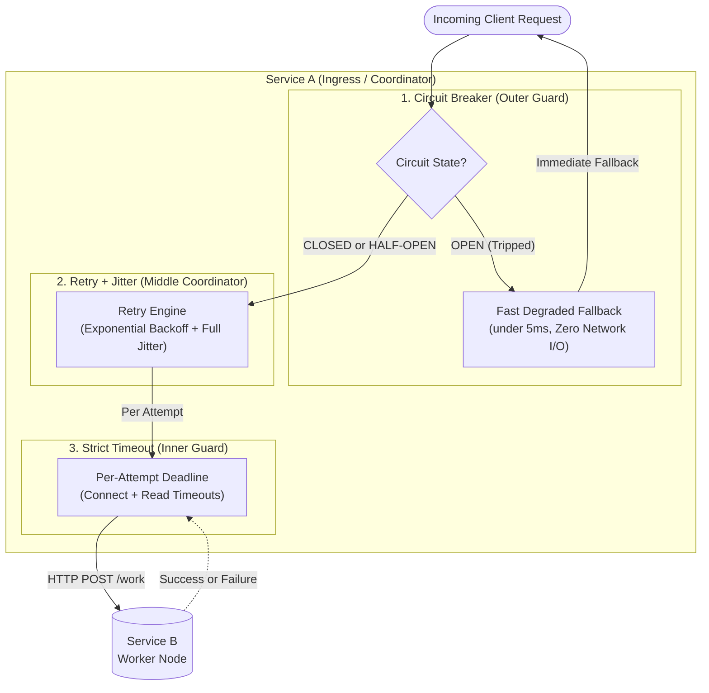

# Milestone 2 Learning Guide: Resilience & Self-Protection

Welcome to the comprehensive learning curriculum for **Milestone 2: Resilience & Self-Protection**. 

In distributed systems, failures are not exceptions—they are a mathematical certainty. Hardware crashes, networks partition, garbage collection pauses freeze runtimes, and databases reach connection limits. When services communicate synchronously over a network, **an unhandled slowdown or crash in one service can take down the entire distributed architecture in seconds**.

This guide covers the theory, mechanics, mathematical models, architectural trade-offs, and common pitfalls of the three core resilience patterns you will implement in Milestone 2.

---

## 📚 Document Index

| Part | Document | What You Will Learn |
| :--- | :--- | :--- |
| **00** | [Distributed Failure Mechanics](./00-distributed-failure-mechanics.md) | The Fallacies of Distributed Computing, Cascading Failures, and Thread Starvation. |
| **01** | [Strict Timeouts](./01-strict-timeouts.md) | Socket mechanics, Connect vs Read timeouts, Tail Latency Amplification, and Resource Isolation. |
| **02** | [Retries, Backoff & Jitter](./02-retries-backoff-jitter.md) | Transient vs Permanent errors, Retry Storms, Exponential Backoff, Full vs Decorrelated Jitter algorithms, and Idempotency risks. |
| **03** | [The Circuit Breaker Pattern](./03-circuit-breaker.md) | The 3-state Finite State Machine (Closed/Open/Half-Open), Rolling Windows, Fallback Strategies, and Self-Healing. |
| **04** | [Pattern Composition & Architecture](./04-pattern-composition.md) | How Timeouts, Retries, and Circuit Breakers nest together; the request lifecycle; and execution order. |
| **Standards** | [Documentation Rules](./DOCUMENTATION_RULES.md) | Quality standards, contrast rules, Mermaid conventions, and things to avoid when writing docs. |

---

## 🧭 The Resilience Triad at a Glance

In Milestone 2, we introduce three complementary layers of defense into **Service A (Ingress / Coordinator)** to protect it against instabilities in **Service B (Worker)**:

---

## 🎯 Learning Objectives

By reading these documents and implementing Milestone 2, you will be able to:
1. Explain why slow services are more dangerous than dead services (**Tail Latency Amplification**).
2. Configure socket timeouts properly, distinguishing connection time from response transmission time.
3. Formulate exponential backoff with full jitter to protect downstream systems from **Retry Storms** (Thundering Herd).
4. Implement a robust **Circuit Breaker** state machine from scratch with `CLOSED`, `OPEN`, and `HALF-OPEN` states.
5. Select safe fallback strategies for degraded operations.
6. Avoid the top 10 classical distributed resilience bugs found in production microservices.
