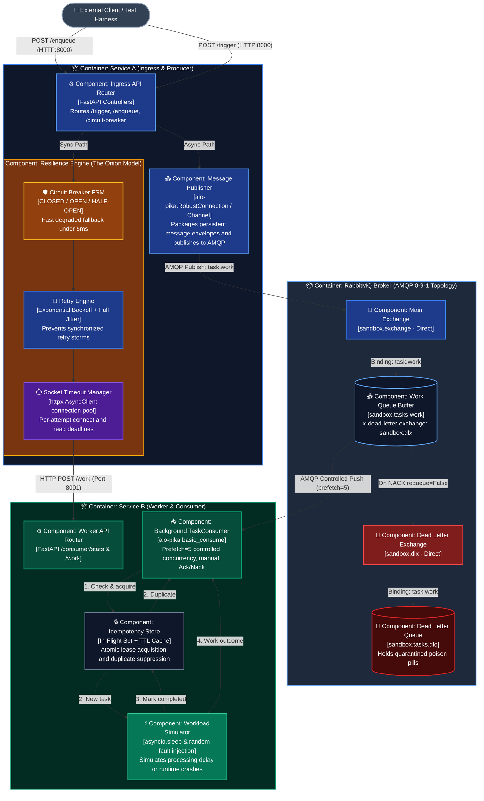

# C4 Level 3: Component Diagram

This document presents the **C4 Component Diagram (Level 3)** for the **Zero-Logic Microservices Architecture Sandbox**.

In the C4 model, a **Component** is a structural building block within a container (such as a router controller, background task loop, or resilience state machine) that encapsulates specific responsibilities.

---

## 1. Visual Component Diagram

---

## 2. Component Breakdown by Container

### Container 1: Service A (Ingress & Producer)

| Component | Path / Module | Responsibility |
| :--- | :--- | :--- |
| **Ingress API Router** | `services/service-a/app/main.py` | FastAPI route handlers for `/enqueue`, `/trigger`, `/circuit-breaker`, and `/health`. Validates syntactic schemas (`EnqueueRequest`). |
| **Circuit Breaker** | `services/service-a/app/resilience/circuit_breaker.py` | 3-state Finite State Machine (`CLOSED`, `OPEN`, `HALF-OPEN`). Fast-fails in under 5ms without making network calls when downstream error thresholds are reached. |
| **Retry Engine** | `services/service-a/app/resilience/retry.py` | Retries transient HTTP errors using Exponential Backoff with Full Jitter: $\text{delay} = \text{random}(0, \text{base} \times 2^{\text{attempt}})$. |
| **Socket Timeout Manager** | `services/service-a/app/main.py` (via `httpx`) | Enforces per-attempt connect and read deadlines on outbound HTTP calls to protect upstream server thread pools. |
| **Message Publisher** | `services/service-a/app/messaging/publisher.py` | Maintains a long-lived AMQP connection/channel and publishes persistent, durable message frames to `sandbox.exchange`. |

---

### Container 2: RabbitMQ Broker (AMQP Topology)

| Component | Entity Name | Type / Properties | Responsibility |
| :--- | :--- | :--- | :--- |
| **Main Exchange** | `sandbox.exchange` | Direct Exchange (`durable=True`) | Central router that receives published tasks from Service A and matches binding keys. |
| **Main Work Queue** | `sandbox.tasks.work` | Durable FIFO Queue | Buffers tasks for Service B. Configured with `x-dead-letter-exchange: sandbox.dlx`. |
| **Dead Letter Exchange (DLX)** | `sandbox.dlx` | Direct Exchange (`durable=True`) | Receives rejected messages that failed processing in Service B without requeue. |
| **Dead Letter Queue (DLQ)** | `sandbox.tasks.dlq` | Durable FIFO Queue | Quarantines poison pills for inspection and post-mortem analysis. |

---

### Container 3: Service B (Worker & Consumer)

| Component | Path / Module | Responsibility |
| :--- | :--- | :--- |
| **Worker API Router** | `services/service-b/app/main.py` | FastAPI route handlers for `/consumer/stats`, `/consumer/dlq`, `/consumer/reset`, and `/work`. |
| **TaskConsumer** | `services/service-b/app/messaging/consumer.py` | Background async consumption loop running in lifespan. Enforces `prefetch_count=5` backpressure and sends manual `ACK`/`NACK`. |
| **Idempotency Store** | `services/service-b/app/messaging/idempotency.py` | Thread-safe deduplication store combining atomic in-flight leases and TTL sliding-window caching to guarantee the **Exactly-Once Effect**. |
| **Workload Simulator** | `services/service-b/app/messaging/consumer.py` | Executes configurable artificial delay (`asyncio.sleep`) and probabilistic failure injection (`random.uniform`). |
| **Topology Initializer** | `services/service-b/app/messaging/topology.py` | Blueprint constructor that idempotently declares exchanges, queues, DLX, DLQ, and bindings on startup. |

---

## 3. End-to-End Component Lifecycle

1. **Ingress & Publish:**
   * Client calls `POST /enqueue` on `RouterA`.
   * `RouterA` passes payload to `Publisher`.
   * `Publisher` formats a JSON envelope with a UUID `request_id`, marks it `DeliveryMode.PERSISTENT`, and flushes it to `MainEx` with routing key `task.work`.
   * `RouterA` immediately returns `HTTP 202 Accepted` to the Client.
2. **Buffering & Delivery:**
   * `MainEx` routes the message into `WorkQ`.
   * RabbitMQ pushes the task to `Consumer` only if Service B's active in-flight count is below `prefetch_count=5`.
3. **Execution & Idempotency:**
   * `Consumer` invokes `IdemStore.check_and_acquire(request_id)`.
   * **If Duplicate:** `Consumer` immediately ACKs without executing work.
   * **If New:** `Consumer` runs `WorkSim`.
4. **Completion or Quarantine:**
   * **Success:** `IdemStore.mark_completed(request_id)`, `Consumer` sends `basic_ack()`.
   * **Poison Failure:** `Consumer` catches exception, releases in-flight lease, and sends `basic_nack(requeue=False)`. RabbitMQ intercepts the rejected message and routes it via `DLX` into `DLQ`.
