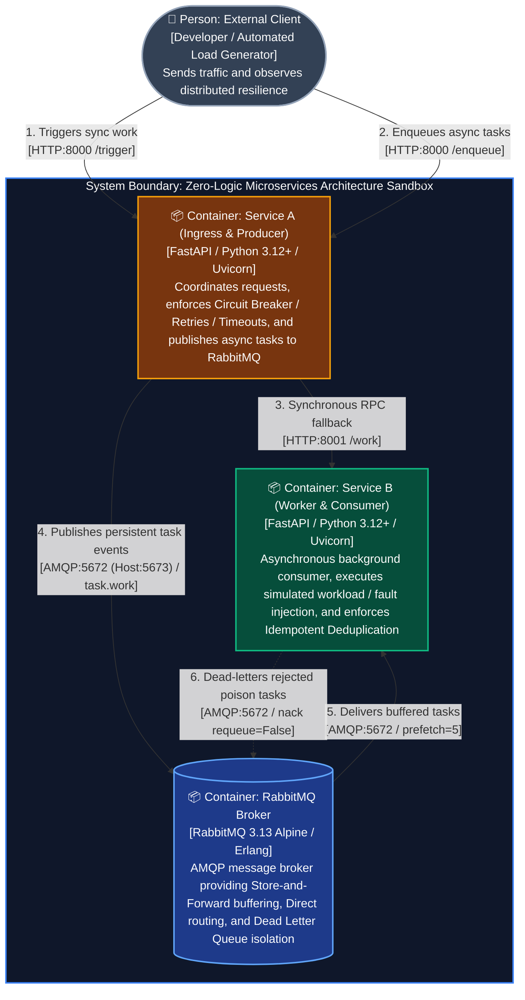

# C4 Level 2: Container Diagram

This document presents the **C4 Container Diagram (Level 2)** for the **Zero-Logic Microservices Architecture Sandbox**.

In the C4 model, a **Container** is an independently deployable or runnable unit (such as a web application server, background worker, or message broker) that executes code or stores data.

---

## 1. Visual Container Diagram

---

## 2. Container Inventory & Specifications

| Container | Technology Stack | Runtime Environment | External Ports | Internal Role & Responsibility |
| :--- | :--- | :--- | :--- | :--- |
| **Service A** | FastAPI, Python 3.12+, Uvicorn, `httpx`, `aio-pika` | Docker Container or Local Process (`uv run`) | `8000:8000` | **Ingress Gateway & Publisher:** Front door for external clients. Coordinates synchronous downstream calls through resilience policies or publishes asynchronous tasks to RabbitMQ. |
| **Service B** | FastAPI, Python 3.12+, Uvicorn, `aio-pika` | Docker Container or Local Process (`uv run`) | `8001:8001` | **Worker & Consumer:** Subscribes to the RabbitMQ work queue, enforces backpressure (`prefetch=5`), executes simulated workloads, detects duplicate tasks, and routes poison messages to DLQ. |
| **RabbitMQ** | RabbitMQ 3.13 Alpine, Erlang OTP VM | Docker Container (`rabbitmq:3.13-management-alpine`) | `5673:5672` (AMQP) `15673:15672` (HTTP) | **Message Broker:** Decouples ingestion from execution. Provides durable queue buffering, direct routing exchanges, and automated dead-letter forwarding. |

---

## 3. Communication Protocols & Data Contracts

### 1. External Client to Service A (HTTP / REST)
* **`POST /trigger` (Milestones 1 & 2):** Synchronous execution. Client waits while Service A calls Service B over HTTP. Returns `HTTP 200 OK` on success, `HTTP 502/504` on downstream failure, or `HTTP 200 (degraded_fallback)` if the circuit breaker is OPEN.
* **`POST /enqueue` (Milestone 3):** Asynchronous ingestion. Service A validates the request, stamps a UUID `request_id`, publishes to RabbitMQ, and returns `HTTP 202 Accepted` in under 10ms.

### 2. Service A to Service B (Synchronous HTTP RPC)
* **`POST /work`:** Direct inter-service HTTP call using `httpx.AsyncClient`. Protected by Service A's Circuit Breaker, Exponential Backoff Retries with Full Jitter, and Strict Socket Timeouts.

### 3. Service A to RabbitMQ (AMQP 0-9-1 Data Plane)
* **Protocol:** AMQP binary framing over a single long-lived TCP connection.
* **Destination:** Direct exchange `sandbox.exchange` with routing key `task.work`.
* **Durability:** Messages are published with `delivery_mode=DeliveryMode.PERSISTENT` to guarantee persistence to disk.

### 4. RabbitMQ to Service B (AMQP 0-9-1 Push / Prefetch)
* **Channel Backpressure:** RabbitMQ pushes tasks up to `prefetch_count=5`. Remaining messages buffer in the queue.
* **Manual Acknowledgments:** Service B acknowledges tasks with `basic_ack()` only after workload execution completes.
* **Dead Lettering:** Failed tasks rejected with `basic_nack(requeue=False)` trigger RabbitMQ's automated forwarding to `sandbox.dlx` $\rightarrow$ `sandbox.tasks.dlq`.

---

## 4. Key Architectural Trade-Offs Illustrated

1. **Spatial Decoupling:** Service A has zero knowledge of Service B's queues (`sandbox.tasks.work` or `sandbox.tasks.dlq`). Service A only addresses the exchange `sandbox.exchange`.
2. **Temporal Decoupling:** In the asynchronous flow, Service B can be completely offline or running at maximum capacity without causing client requests to fail or time out at Service A.
3. **Fault Domain Isolation:** Failures in background tasks are quarantined in the Dead Letter Queue without halting or degrading active ingestion.
