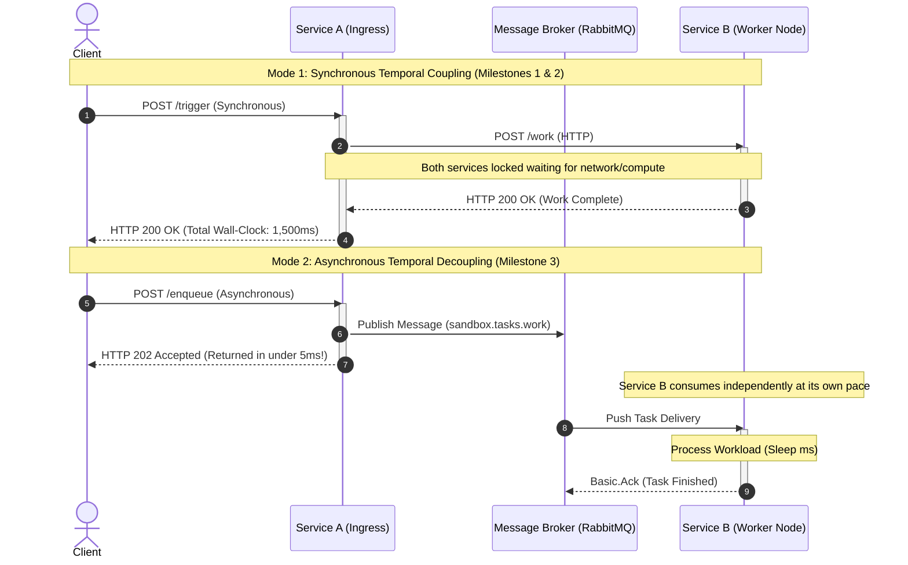
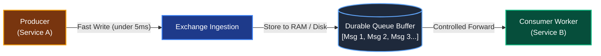
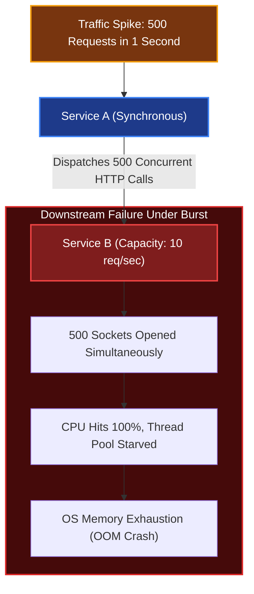
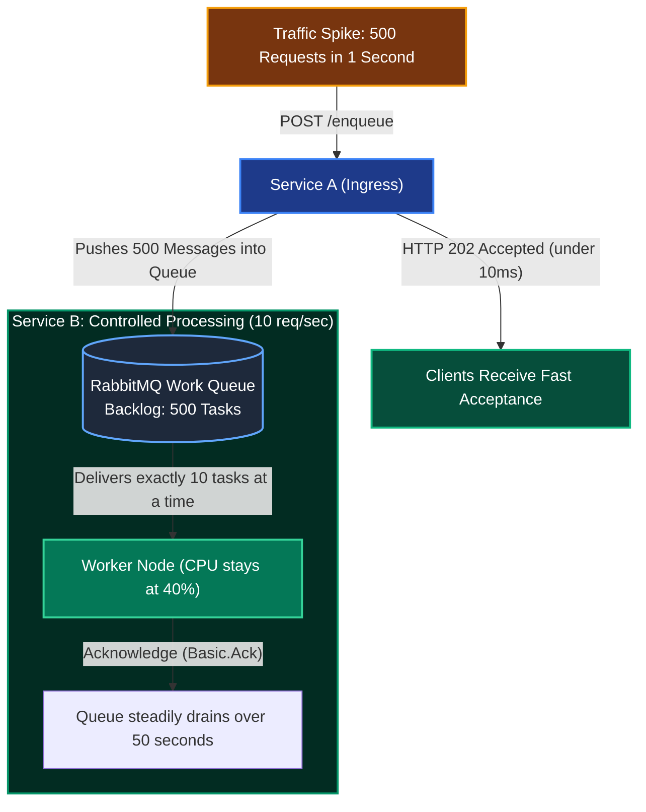

# Part 0: Asynchronous Decoupling & Load Leveling

In Milestones 1 and 2, our services communicated via **Synchronous Remote Procedure Calls (HTTP RPC)**. While synchronous communication is simple and familiar, it introduces strict architectural constraints that severely limit how systems scale and recover from failure.

This document explores the fundamental concepts behind **Asynchronous Decoupling**, the **Store-and-Forward** architecture, and the **Load Leveling (Queue Buffering)** pattern.

---

## 1. Temporal vs. Spatial Coupling

To understand why message brokers exist, we must distinguish between two forms of architectural coupling:

### A. Spatial Coupling (Where does the service live?)
* **Definition:** Does Service A need to know the physical network location (IP address, hostname, port) of Service B?
* **In Synchronous HTTP:** Yes. Service A must know `http://service-b:8001/work`. If Service B changes its IP or port, Service A cannot talk to it unless a Service Discovery layer (like Consul or Kubernetes DNS) intervenes.
* **In Asynchronous Queuing:** No. Service A only knows the address of the **Message Broker**. Service A publishes a message to an Exchange; it has zero knowledge of who receives it, how many workers exist, or where they are hosted.

### B. Temporal Coupling (When does the service execute?)
* **Definition:** Do Service A and Service B need to be **online and available at the exact same millisecond** to complete a request?
* **In Synchronous HTTP:** **YES.** If Service B is restarting, undergoing a deployment, or pausing for garbage collection, Service A's call immediately fails or times out. Both systems are locked in time.
* **In Asynchronous Queuing:** **NO.** If Service B is powered down for 20 minutes, Service A continues to accept incoming requests from users without interruption. The broker safely buffers the messages until Service B boots back up.

---

## 2. The "Store-and-Forward" Pattern

In synchronous architecture, network packets travel directly from caller to receiver over ephemeral TCP sockets. If the receiving socket cannot keep up, packets are dropped and connections reset.

In an asynchronous architecture, the intermediary acts as a **durable shock absorber** implementing the **Store-and-Forward** pattern:

### Key Properties of Store-and-Forward:
1. **Durable Persistence:** Messages can be written to disk so they survive a complete power outage or crash of the broker itself.
2. **Backpressure Decoupling:** The ingestion rate of the producer is completely isolated from the consumption rate of the consumer.
3. **Fault Tolerance:** If a worker crashes midway through processing a task, the unacknowledged message remains safely in the queue and is automatically redelivered to a surviving worker.

---

## 3. The Load Leveling Pattern (Queue-Based Buffering)

In production systems, traffic is rarely a constant, predictable trickle. It arrives in **spikes and bursts**:
* E-commerce flash sales or product drops.
* Batch cron jobs triggering thousands of actions at midnight.
* Webhook storms from third-party payment providers.

### Scenario A: Without Load Leveling (Synchronous RPC Under a 500 Req Burst)

Suppose Service B's hardware can handle a maximum of **10 requests per second**:

**Result:** Service B collapses completely. Upstream Service A times out on hundreds of calls, and clients receive a wave of `502 Bad Gateway` and `504 Gateway Timeout` errors.

---

### Scenario B: With Load Leveling (Asynchronous Queue Buffering)

Now we introduce a message queue between Service A and Service B:

**Result:**
* **0% Error Rate:** Service A successfully accepts all 500 requests in less than 1 second.
* **Stable Downstream:** Service B never experiences concurrency beyond its 10 tasks/second limit. Its CPU, memory, and database connections remain stable.
* **Smooth Backlog Draining:** Over the next 50 seconds, Service B drains the queue at a steady, controlled pace until the backlog returns to zero.

---

## 4. Throughput vs. Latency Curve Comparison

The following matrix compares how Synchronous RPC behaves versus Asynchronous Queuing when system load increases:

| Metric | Synchronous RPC (Milestones 1 & 2) | Asynchronous Queuing (Milestone 3) |
| :--- | :--- | :--- |
| **Ingress Wall-Clock Latency** | Dependent on worker duration (e.g. 500ms to 5,000ms). | Near-instantaneous (under 10ms for `HTTP 202 Accepted`). |
| **Max Ingestion Throughput** | Bounded by downstream concurrency and thread limits. | Bounded only by broker write throughput (thousands of msgs/sec). |
| **Failure Blast Radius** | Downstream failure immediately degrades upstream caller. | Downstream failure is completely invisible to client ingestion. |
| **Client Interaction Model** | Request-Response (Client waits for final answer). | Eventual Consistency (Client polls, receives webhook, or fires-and-forgets). |
| **System Complexity** | Lower (No message broker infrastructure required). | Higher (Requires broker operational management, DLQs, idempotency). |

---

## 5. Summary & Checklist for Milestone 3

- [x] Understand temporal decoupling: Service A and Service B do not need to be online at the same time.
- [x] Understand the Load Leveling pattern: Queues act as shock absorbers for traffic spikes.
- [x] Design Service A to return `HTTP 202 Accepted` immediately upon publishing.
- [x] Enforce controlled concurrency in Service B so it never exceeds its processing capacity.
