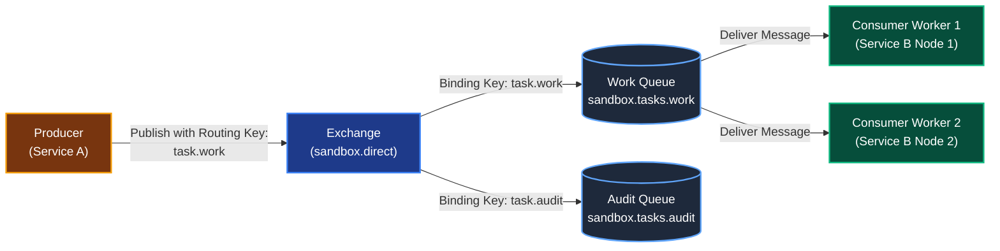
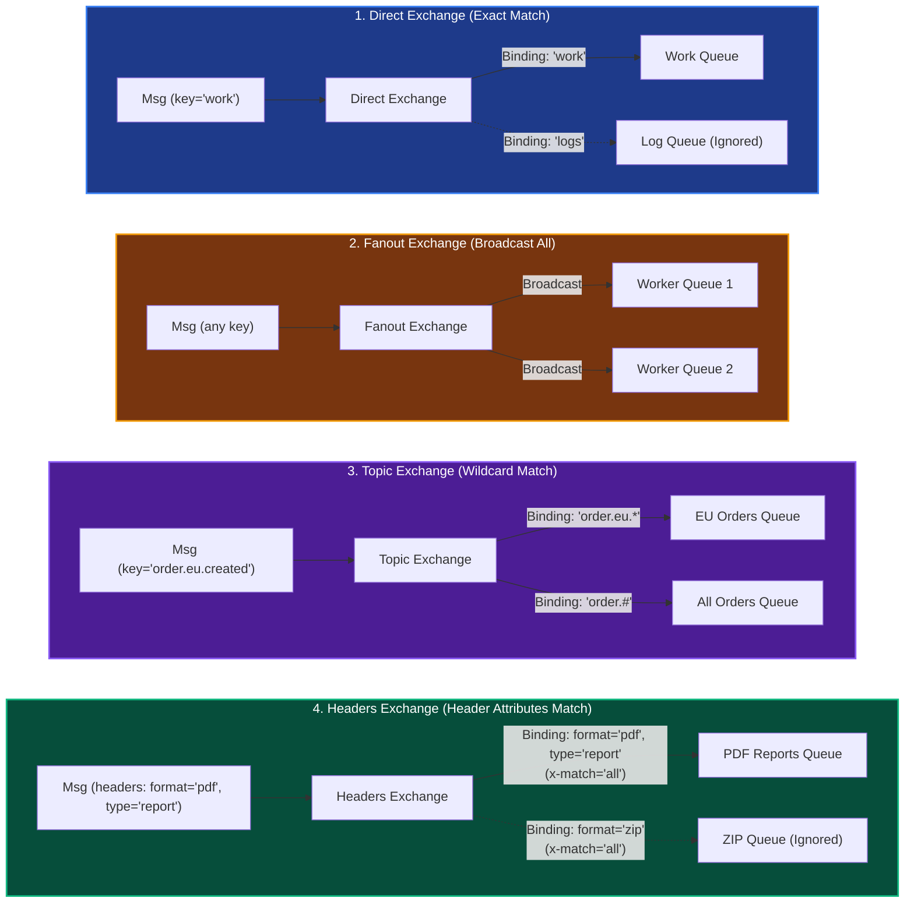
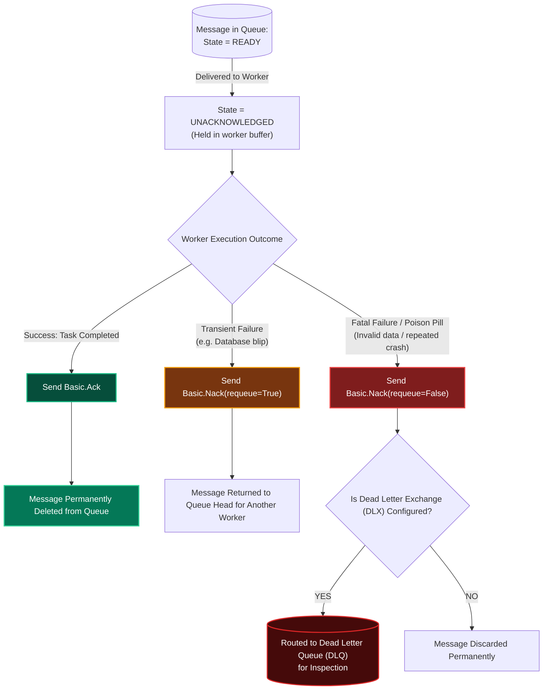
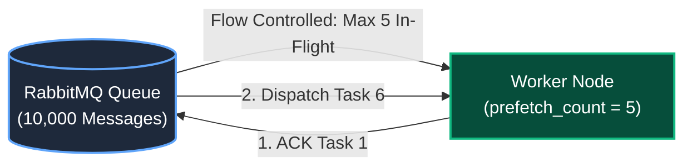

# Part 1: Message Broker & AMQP Fundamentals

To build reliable asynchronous microservices, we must understand how modern message brokers operate. In this project, we use **RabbitMQ**, the industry-standard implementation of the **AMQP 0-9-1 (Advanced Message Queuing Protocol)** specification.

Unlike simple Redis lists or HTTP webhooks, AMQP provides formal networking guarantees: dynamic routing, message durability, explicit delivery acknowledgments, and fine-grained backpressure controls.

---

## 1. The AMQP 0-9-1 Mental Model

In AMQP, **producers never publish messages directly into a queue**. Instead, messages flow through a sequence of specialized abstractions:

### The Core AMQP Entities:

1. **Producer:** An application (Service A) that publishes messages to an exchange.
2. **Exchange:** An in-broker message router. It receives messages from producers and determines which queues should receive a copy based on predefined rules (**Bindings**).
3. **Binding:** A configuration link that connects an exchange to a queue (e.g. *"Route messages with routing key `task.work` to the queue `sandbox.tasks.work`"*).
4. **Routing Key:** A metadata string attached to every published message by the producer (like an envelope address).
5. **Queue:** A first-in, first-out (FIFO) storage buffer that holds messages in memory or on disk until consumers acknowledge them.
6. **Consumer:** A worker service (Service B) that subscribes to a queue, receives messages, executes the requested task, and sends an acknowledgment back.

---

## 2. The 4 Types of AMQP Exchanges

The Exchange type determines **how** the broker matches routing keys to queue bindings:

### Summary of Exchange Types:

| Exchange Type | Routing Logic | Typical Use Case |
| :--- | :--- | :--- |
| **Direct** | Exact string match between Routing Key and Binding Key. | **Task / Work Queues (Used in our Sandbox)**. Point-to-point worker dispatch. |
| **Fanout** | Ignores routing keys completely. Clones message to **all bound queues**. | Pub/Sub notifications, real-time analytics feeds, cache invalidation broadcast. |
| **Topic** | Matches routing keys using wildcard patterns (`*` matches 1 word; `#` matches 0 or more words). | Regional routing (e.g. `sensors.us-east.temperature`), multi-tenant feeds. |
| **Headers** | Routes based on message header key-value attributes instead of routing keys. | Complex routing where headers contain routing metadata. |

---

## 3. The Message Acknowledgment Lifecycle

In synchronous HTTP, delivery confirmation happens implicitly when the TCP socket closes. In asynchronous systems, **workers can crash midway through a task**. 

RabbitMQ solves this with explicit **Delivery Acknowledgments (ACK / NACK)**:

### The Three Critical Rules of Acknowledgments:
1. **Never use auto-ack (`no_ack=True` / `auto_ack=True`):**
   * If auto-ack is enabled, RabbitMQ deletes the message from the queue the instant it pushes it over the network socket. If the worker container gets killed by the OS (OOM) 1 millisecond later, **the message is lost forever**.
2. **Always send manual ACKs after the work is done:**
   * Only send `basic_ack()` when your function has fully completed its computation or database commit.
3. **Beware of `requeue=True`:**
   * If a message crashes because the payload has invalid JSON or a corrupt field, sending `nack(requeue=True)` puts it right back at the top of the queue. The worker picks it up and crashes again immediately, creating an **infinite CPU-pegged crash loop**.

---

## 4. Backpressure & Consumer Prefetch (`prefetch_count`)

What happens when a producer dumps 10,000 tasks into RabbitMQ?

### Without Prefetch (The Default Trap):
* By default, RabbitMQ attempts to push **all 10,000 messages** into the connected consumer as fast as the network allows.
* The consumer's Python process buffers all 10,000 messages in process memory (`RAM`), triggering:
  * Extreme memory consumption.
  * Starvation of other worker nodes (one worker hoards all messages while other workers sit idle).

### With Prefetch (`basic_qos(prefetch_count=N)`):
* **`prefetch_count`** tells RabbitMQ: *"Do not send me more than $N$ unacknowledged messages at any given time."*
* If you set `prefetch_count = 5`:
  * RabbitMQ sends 5 tasks to the worker.
  * RabbitMQ **pauses** and holds the remaining 9,995 tasks in the broker queue.
  * Only when the worker completes Task #1 and sends `basic_ack()` does RabbitMQ dispatch Task #6.

> **Direct Connection to PRD Requirement FR-3.2:**  
> Setting `prefetch_count` is the exact mechanism that enables **Controlled Concurrency**. It allows us to mathematically limit worker load regardless of how huge the incoming traffic spike is.

---

## 5. Summary & Checklist for Milestone 3

- [x] Configure a **Direct Exchange** (`sandbox.exchange`) bound to the work queue.
- [x] Mark queues and messages as **Durable** (`durable=True`, `delivery_mode=PERSISTENT`).
- [x] Use **manual message acknowledgments**; never enable automatic ACKs.
- [x] Configure channel **`prefetch_count`** (e.g. 5) to enforce consumer backpressure.
- [x] Catch fatal task errors and reject with `requeue=False` to trigger DLQ routing.
