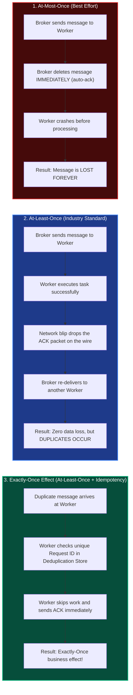
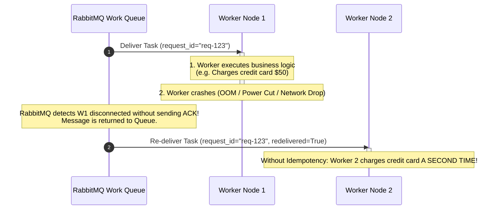
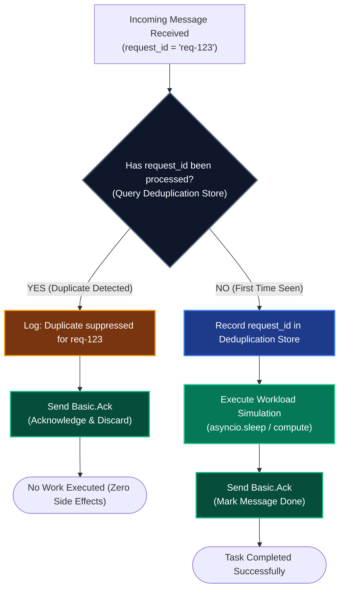

# Part 2: Delivery Guarantees & Idempotency

When transitioning from synchronous REST to asynchronous messaging, many developers assume that the message broker guarantees **"Exactly-Once Delivery"**. 

In distributed systems, **true network-level exactly-once delivery is physically impossible** (proven by the *Two Generals' Problem*). Modern message brokers (RabbitMQ, Apache Kafka, AWS SQS) provide **At-Least-Once Delivery**.

Because messages can and will be delivered more than once, consumer services must be designed using the **Idempotent Consumer Pattern** to achieve an *exactly-once processing effect*.

---

## 1. The Three Delivery Guarantees

### Breakdown of Guarantees:

| Guarantee | How It Works | Trade-off | Used When? |
| :--- | :--- | :--- | :--- |
| **At-Most-Once** | Auto-ack enabled (`no_ack=True`). Broker forgets message as soon as sent. | High speed, but **data loss is guaranteed** if workers crash. | High-frequency telemetry, non-critical metrics, GPS coordinates. |
| **At-Least-Once** | Manual ACKs. Message stays in queue until worker explicitly confirms. | **Zero message loss**, but consumers must handle duplicate messages. | **Standard for financial, order, and business processing**. |
| **Exactly-Once** | Theoretical ideal at the transport layer. | Impossible across distributed networks without application-level deduplication. | Achieved via **Idempotent Consumers**. |

---

## 2. Why Do Duplicate Messages Occur?

Duplicates are not an anomaly; they are a normal operational reality in distributed systems. Here are the two most common root causes:

### Cause A: Worker Crashes Right Before Sending the ACK

### Cause B: Producer Retry During Network Hiccups
1. Service A publishes a message to RabbitMQ.
2. RabbitMQ writes the message to the queue.
3. The network connection drops before RabbitMQ's publisher confirmation reaches Service A.
4. Service A's retry engine (from Milestone 2) assumes the message was lost and publishes it a second time.
5. The queue now holds **two identical messages with the same payload**.

---

## 3. The Idempotent Consumer Pattern

### What is an Idempotent Operation?
Mathematically, an operation $f$ is **idempotent** if applying it multiple times yields the exact same state as applying it once:

$$f(f(x)) = f(x)$$

### The 4-Step Idempotency Protocol:

---

## 4. Deduplication Store Options in Production

To detect duplicates, Service B needs a mechanism to remember which `request_id` values it has already seen:

| Storage Type | Mechanism | Pros | Cons / Trade-offs |
| :--- | :--- | :--- | :--- |
| **In-Memory Cache (Sandbox)** | Thread-safe `set[str]` or `collections.OrderedDict` with TTL. | Zero external dependencies, sub-millisecond lookup. | Lost if the worker process restarts; isolated per worker instance. |
| **Distributed Cache (Redis)** | `SET request_id "processed" EX 86400 NX` | Shared across all worker nodes, automatic TTL expiration. | Requires Redis infrastructure; network hop overhead (1-2ms). |
| **Database Unique Constraint** | `INSERT INTO processed_tasks (id) VALUES (...) ON CONFLICT DO NOTHING` | **100% ACID consistency**; shares same transaction with business data. | Higher database write overhead; requires table cleanup cron. |

---

## 5. Summary & Checklist for Milestone 3

- [x] Accept that network messaging is fundamentally **At-Least-Once**.
- [x] Attach a unique `request_id` to every published message envelope.
- [x] Implement the **Idempotent Consumer Pattern** in Service B (`FR-3.3`).
- [x] Acknowledge duplicate messages immediately without executing workload to avoid queue blockage.
- [x] Verify the **Exactly-Once Effect**: Publishing the same `request_id` 5 times results in exactly 1 execution and 4 skips.
