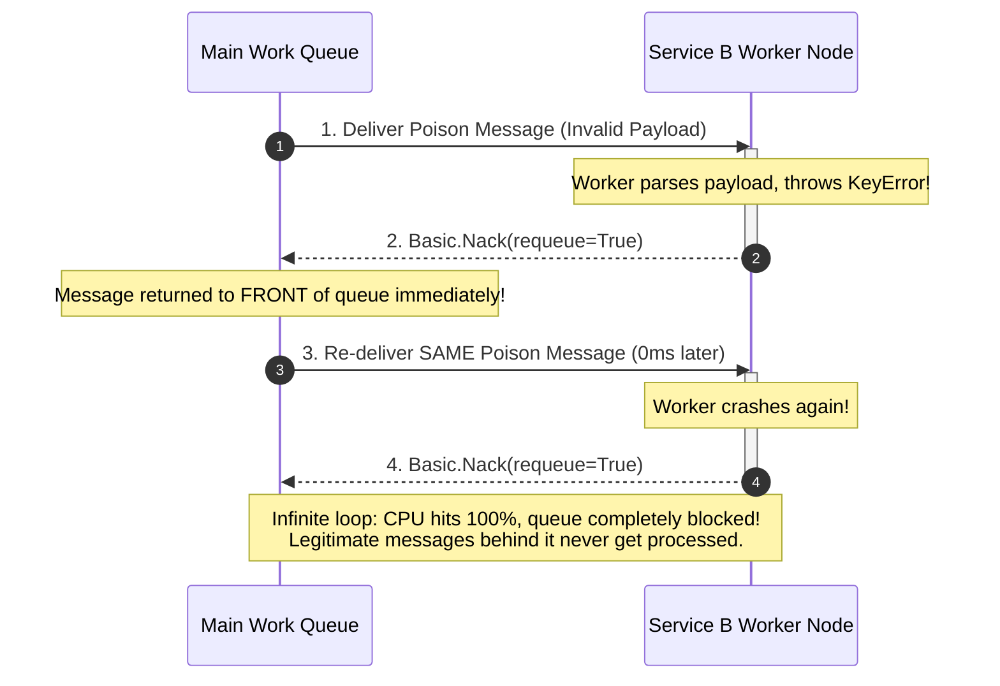
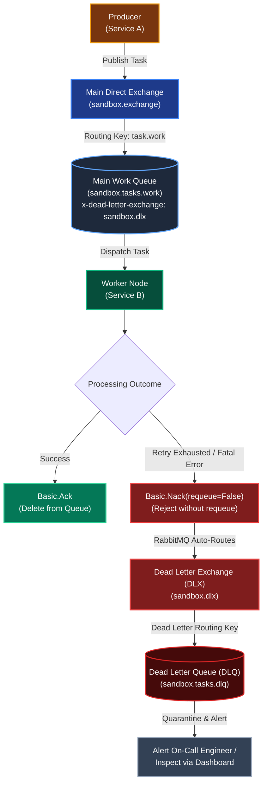
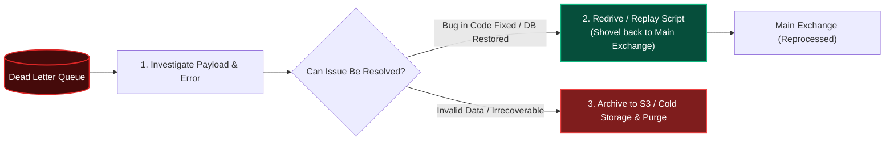

# Part 3: Dead Letter Queues & Poison Message Isolation

In a perfect world, every message arriving at a worker is well-formed, valid, and completes successfully. In production systems, however, certain messages will fail no matter how many times you retry them. 

A message that permanently crashes its consumer is known as a **Poison Message** (or **Poison Pill**). Without proper architectural handling, a single poison message can completely freeze an entire queue, preventing thousands of subsequent healthy tasks from ever executing.

The **Dead Letter Queue (DLQ)** pattern isolates unprocessable messages into a dedicated quarantine area for offline inspection, allowing the main pipeline to continue operating at full speed.

---

## 1. The Anatomy of a Poison Message

A message becomes "poisonous" when its failure is deterministic and non-transient:
* **Schema/Serialization Mismatch:** The producer published JSON with a missing mandatory field or an unexpected data type.
* **Bug in Consumer Code:** The payload triggers an unhandled `IndexError`, `ZeroDivisionError`, or `KeyError` inside the worker's business logic.
* **Corrupt Data:** A payload containing invalid Unicode, binary noise, or malformed values.
* **Simulated 100% Failure Rate:** In our sandbox, a task specifically injected with `failure_rate_pct = 100.0`.

---

## 2. The Disaster of Naive Requeuing (The Poison Loop)

Consider what happens when a developer catches an exception and blindly tells RabbitMQ to requeue:



**The Disaster:**
* The worker enters an **infinite crash loop**.
* CPU usage spikes to 100% as the same message is dispatched, crashed, and requeued thousands of times per second.
* **Queue Head-of-Line Blocking:** Because the poison message sits at the front of the FIFO queue, every legitimate user task queued behind it is starved indefinitely.

---

## 3. The Dead Letter Queue (DLQ) Architecture

To break the poison loop, RabbitMQ provides native support for **Dead Letter Exchanges (DLX)**:



### How Dead Lettering Works in RabbitMQ:
1. When declaring the main queue (`sandbox.tasks.work`), we attach queue arguments:
   ```python
   arguments = {
       "x-dead-letter-exchange": "sandbox.dlx",
       "x-dead-letter-routing-key": "task.dead",
   }
   ```
2. When Service B encounters an unprocessable message or exhausts its internal retries, it rejects the message with **`requeue=False`**:
   ```python
   # In aio-pika / AMQP:
   await message.nack(requeue=False)
   ```
3. Instead of dropping the message into the void, RabbitMQ automatically re-publishes it to `sandbox.dlx`, which routes it into `sandbox.tasks.dlq`.
4. The main queue is now completely clear, and subsequent tasks continue processing without delay!

---

## 4. The Diagnostic `x-death` Header

When RabbitMQ dead-letters a message, it automatically annotates the message headers with an array called **`x-death`**.

This provides complete forensics for debugging:
```json
{
  "x-death": [
    {
      "count": 1,
      "exchange": "sandbox.exchange",
      "queue": "sandbox.tasks.work",
      "reason": "rejected",
      "routing-keys": ["task.work"],
      "time": 1729252800
    }
  ]
}
```

* **`reason: "rejected"`**: Proves the message was rejected by a worker via `nack(requeue=False)`.
* **`queue: "sandbox.tasks.work"`**: Identifies the exact origin queue where the failure occurred.
* **`count: 1`**: Shows how many times this specific message has passed through dead-lettering.

---

## 5. Operational DLQ Remediation Strategies

What do engineers do with messages trapped in a Dead Letter Queue?



1. **Alerting:** A metric alert fires whenever `sandbox.tasks.dlq` has a message count $> 0$.
2. **Investigation:** Developers inspect the poison payload and error logs to identify the root cause.
3. **Replay / Redrive:** Once the bug in consumer code is deployed or downstream database is restored, a script or RabbitMQ **Shovel Plugin** replays the messages from the DLQ back into the main exchange for reprocessing.

---

## 6. Summary & Checklist for Milestone 3

- [x] Configure a dedicated Dead Letter Exchange (`sandbox.dlx`) and Dead Letter Queue (`sandbox.tasks.dlq`) (`FR-3.4`).
- [x] Configure `x-dead-letter-exchange` on the primary work queue.
- [x] Catch unrecoverable processing failures in Service B and reject with `requeue=False`.
- [x] Confirm that poison messages move to the DLQ while healthy messages in the main queue continue uninterrupted.
