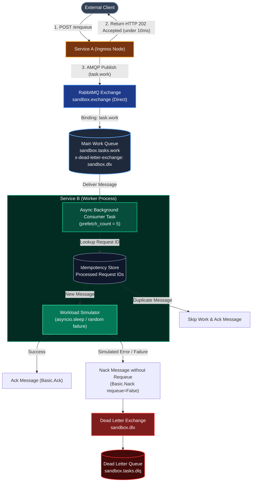
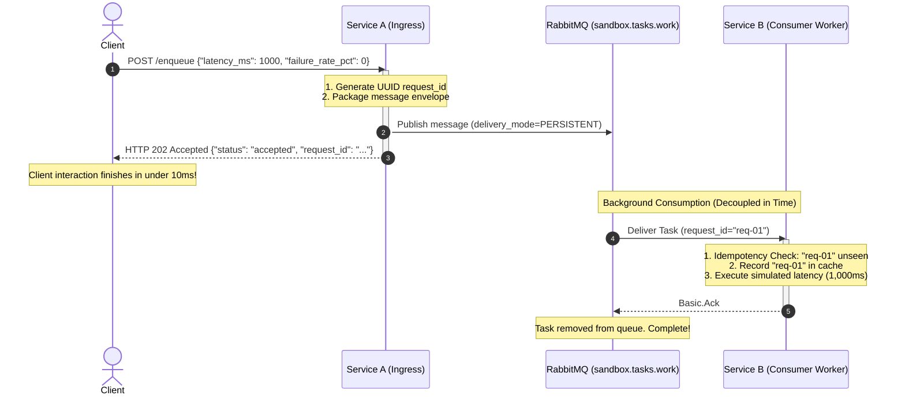
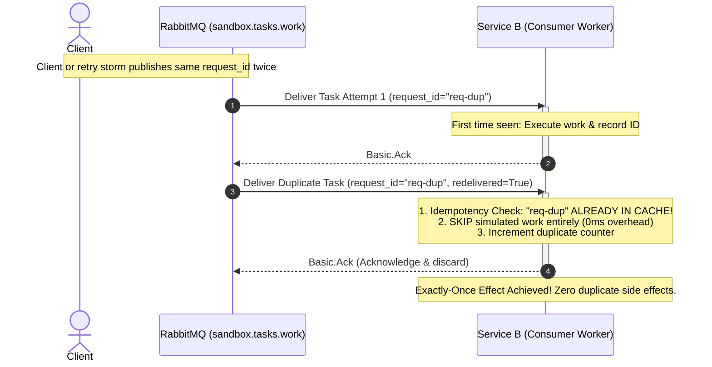
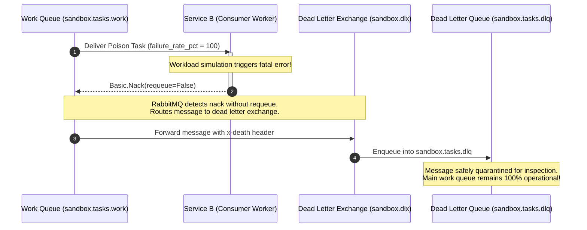

# Part 4: Async Architecture & Message Lifecycle

This document presents the complete architectural specification for **Milestone 3: Asynchronous Decoupling & Reliability**, detailing the end-to-end message lifecycle, operational sequence diagrams, and Python implementation structure using **`aio-pika`**.

---

## 1. System Architecture Overview

In Milestone 3, client traffic is no longer tethered to downstream execution:



---

## 2. Operational Sequence Diagrams

### Scenario 1: Happy Path Asynchronous Ingestion & Background Execution



---

### Scenario 2: Duplicate Delivery Suppression (Idempotent Deduplication)



---

### Scenario 3: Poison Message Routing to Dead Letter Queue (DLQ)



---

## 3. Technology Choice: `aio-pika`

For interacting with RabbitMQ from FastAPI, we select **`aio-pika`**:
* **Why not `pika`?** Standard `pika` is synchronous and blocking. Calling it in an async FastAPI route freezes the event loop.
* **Why `aio-pika`?** Built specifically for Python's `asyncio` event loop. It provides non-blocking connection pooling, robust channel recycling, and native Python context managers (`async with message.process():`).

---

## 4. Code Structure Plan for Milestone 3

```text
services/
├── service-a/
│   └── app/
│       ├── config.py                 # RabbitMQ connection URL and exchange names
│       ├── main.py                   # POST /enqueue endpoint and broker lifespan
│       ├── schemas.py                # EnqueueRequest and EnqueueResponse schemas
│       └── messaging/
│           ├── __init__.py
│           └── publisher.py          # aio-pika persistent connection and publisher pool
│
└── service-b/
    └── app/
        ├── config.py                 # RabbitMQ connection URL and prefetch settings
        ├── main.py                   # FastAPI app with telemetry (GET /consumer/stats)
        ├── schemas.py                # Task telemetry schemas
        └── messaging/
            ├── __init__.py
            ├── consumer.py           # Background consumption loop (basic_consume)
            ├── idempotency.py        # Thread-safe in-memory deduplication cache with TTL
            └── topology.py           # Broker setup: exchanges, work queue, DLX, DLQ
```

---

## 5. Acceptance Criteria Verification Plan

| PRD Acceptance Requirement | Test Scenario | Verification Method |
| :--- | :--- | :--- |
| **Load Leveling (Buffer)** | Burst of **500 requests** sent in 1 second to Service A while Service B is limited to **10 requests/sec**. | Verify 0% error rate at Service A (`202 Accepted`), maximum memory stability at Service B, and steady queue draining over 50 seconds. |
| **Exactly-Once Effect** | Publish the exact same `request_id` **5 times** to RabbitMQ. | Verify Service B executes the workload exactly **once** and suppresses/acknowledges the remaining **4 attempts**. |
| **Poison Message Isolation** | Send a task with `failure_rate_pct = 100.0`. | Verify Service B rejects the message, RabbitMQ routes it to `sandbox.tasks.dlq`, and subsequent tasks in `sandbox.tasks.work` are not blocked. |

---

*This concludes the Milestone 3 architectural and learning documentation. We are ready to begin implementation!*
