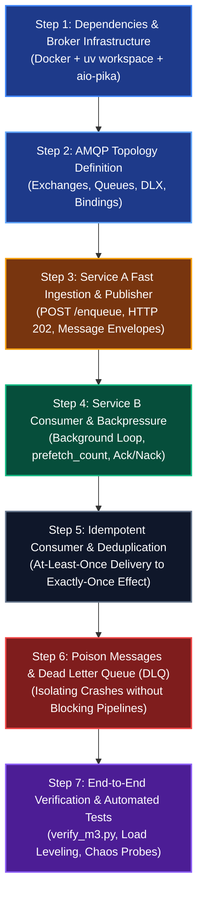

# Milestone 3 Implementation Plan: Step-by-Step Roadmap

Welcome to the hands-on implementation phase of **Milestone 3: Asynchronous Decoupling & Reliability**.

This roadmap is designed as a **collaborative, inquiry-based guide**, not a copy-paste cheatsheet. Microservices and message brokers introduce asynchronous concepts that fundamentally differ from synchronous HTTP request-response APIs. 

By working through these steps iteratively, you will reason through the design decisions, predict outcomes, and build deep intuition for real-world message brokering.

---

## 🗺️ The 7-Step Implementation Journey

---

## 🎯 Step-by-Step Breakdown

### Step 1: Dependencies & Broker Infrastructure
* **The Goal:** Make sure RabbitMQ is running and both Python services have the non-blocking driver installed.
* **Key Concepts:** AMQP port (`5672`) vs Management UI port (`15672`), async networking drivers (`aio-pika`), connection URLs.
* **Questions you will explore:**
  * Why can't we use standard `pika` in an async FastAPI app?
  * What settings does each service need in its configuration to find the broker?

---

### Step 2: AMQP Topology Setup (Exchanges, Queues, Bindings)
* **The Goal:** Establish the messaging blueprint inside RabbitMQ before any messages are sent.
* **Key Concepts:** Idempotent declaration (`exchange_declare`, `queue_declare`), Dead Letter Exchange (`DLX`) arguments, Direct routing keys.
* **Questions you will explore:**
  * Should Service A, Service B, or an independent init step declare the queues?
  * How do we tell RabbitMQ to automatically redirect failed messages to a Dead Letter Queue?

---

### Step 3: Service A Fast Ingestion & Publisher
* **The Goal:** Build the `POST /enqueue` endpoint that accepts requests, attaches metadata, publishes to RabbitMQ, and returns immediately.
* **Key Concepts:** HTTP `202 Accepted` vs `200 OK`, message persistence (`delivery_mode=PERSISTENT`), long-lived connections vs per-request connections.
* **Questions you will explore:**
  * Should we open a new TCP connection to RabbitMQ for every incoming HTTP request?
  * What fields should be in the message payload envelope so downstream workers have full context?

---

### Step 4: Service B Consumer & Backpressure
* **The Goal:** Turn Service B into a worker that continuously pulls and processes messages in the background.
* **Key Concepts:** FastAPI `lifespan` background worker tasks, `basic_qos(prefetch_count=N)`, manual acknowledgments (`basic_ack`).
* **Questions you will explore:**
  * Where does a consumer loop live inside a FastAPI service?
  * What disastrous thing happens if a worker consumes messages without setting `prefetch_count`?

---

### Step 5: Idempotency & Deduplication
* **The Goal:** Ensure that network redeliveries or duplicate publish attempts do not trigger duplicate work.
* **Key Concepts:** The Idempotent Consumer Pattern, deduplication cache with TTL, state verification.
* **Questions you will explore:**
  * If a message is a duplicate, should we `Ack` it or `Nack` it?
  * How long should Service B remember seen message IDs?

---

### Step 6: Poison Messages & Dead Letter Quarantine (DLQ)
* **The Goal:** Handle tasks that fail processing (e.g., simulated 100% failure rate) cleanly without crashing the worker or blocking the queue.
* **Key Concepts:** Poison pills, `basic_nack(requeue=False)`, Dead Letter Queue monitoring.
* **Questions you will explore:**
  * Why is `requeue=True` dangerous when a task fails due to a bug in the code or corrupt payload?
  * How can we observe messages sitting in the Dead Letter Queue?

---

### Step 7: Verification & Automated Tests
* **The Goal:** Empirically verify all three PRD non-functional requirements (Load Leveling, Exactly-Once Effect, Fault Isolation) via tests and CLI scripts.
* **Key Concepts:** End-to-end integration tests (`pytest`), load injection (`scripts/verify_m3.py`), RabbitMQ HTTP management API checks.
* **Questions you will explore:**
  * How does response time at Service A change under a 500-request burst compared to Milestone 1?

---

## 🤝 How We Will Collaborate

At each step:
1. **The Scenario:** I will outline the goal and the challenge.
2. **Your Turn to Guess:** You tell me what you think we need to do, what components we need to touch, or how you think the flow works.
3. **Epistemic Feedback:** I will validate your reasoning, challenge any misconceptions or edge cases, and clarify the exact mechanics.
4. **Execution:** We write and test the code together, ensuring clean tests and zero lint errors.
