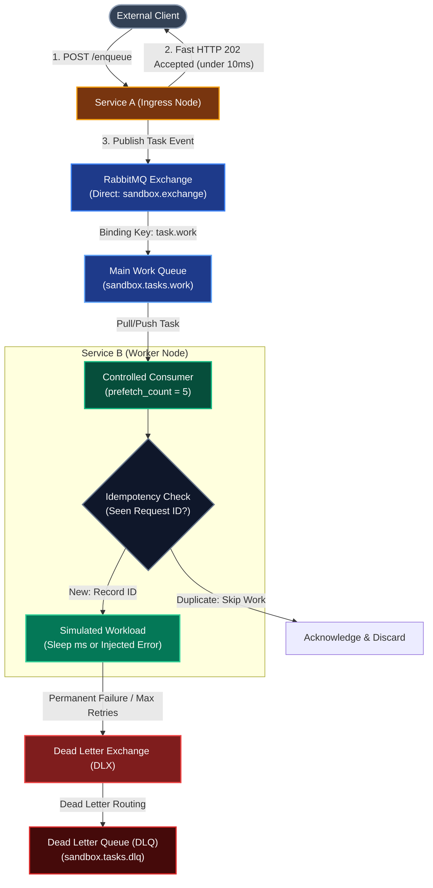

# Milestone 3 Learning Guide: Asynchronous Decoupling & Reliability

Welcome to the comprehensive learning curriculum for **Milestone 3: Asynchronous Decoupling & Reliability**.

In Milestones 1 and 2, we explored synchronous HTTP request-response communication between **Service A (Ingress / Coordinator)** and **Service B (Worker)**. While we added self-protection patterns (timeouts, retries, and circuit breakers), the architecture remained fundamentally **temporally coupled**: Service A's ability to complete a request depended directly on Service B's immediate availability and processing speed.

In Milestone 3, we transition from synchronous RPC to **Event-Driven Asynchronous Architecture** using **RabbitMQ** as a message broker.

---

## 📚 Document Index

| Part | Document | What You Will Learn |
| :--- | :--- | :--- |
| **00** | [Async Decoupling & Load Leveling](./00-async-decoupling-and-load-leveling.md) | Temporal vs Spatial coupling, the Store-and-Forward pattern, Load Leveling (Queue Buffering), and Throughput vs Latency trade-offs. |
| **01** | [Message Broker & AMQP Fundamentals](./01-message-broker-fundamentals.md) | RabbitMQ architecture, AMQP 0-9-1 model, Exchanges, Queues, Bindings, Routing Keys, Ack/Nack lifecycle, and Consumer Prefetch backpressure. |
| **02** | [Delivery Guarantees & Idempotency](./02-delivery-guarantees-and-idempotency.md) | At-Most-Once vs At-Least-Once delivery, why duplicate deliveries occur, and implementing the Idempotent Consumer pattern for exactly-once effects. |
| **03** | [Dead Letter Queues & Poison Messages](./03-dead-letter-queues-and-poison-messages.md) | Poison pills, infinite retry crash loops, Dead Letter Exchanges (DLX), Dead Letter Queues (DLQ), and manual/automated remediation. |
| **04** | [Async Architecture & Message Lifecycle](./04-async-architecture-and-message-lifecycle.md) | End-to-end request lifecycle, sequence diagrams for all operational scenarios, and implementation design using `aio-pika`. |
| **05** | [Broker Infrastructure & Connection Mechanics](./05-broker-infrastructure-and-connection-mechanics.md) | Data plane vs control plane, AMQP URI anatomy, Docker bridge vs host networking, and producer/consumer configuration asymmetry. |
| **Q&A-1** | [Step 1 Q&A Record](./qa-step-1-broker-infrastructure.md) | Verbatim plain Q&A record of initial step 1 questions, user answers, and follow-up architectural explorations. |
| **Plan** | [Implementation Roadmap](./IMPLEMENTATION_PLAN.md) | 7-step guided implementation plan from dependencies to end-to-end verification. |
| **Standards** | [Documentation Rules](../DOCUMENTATION_RULES.md) | Quality standards, contrast rules, Mermaid conventions, and pre-commit checklists. |

---

## 🧭 Asynchronous Decoupling at a Glance

In Milestone 3, we place a message broker between Service A and Service B to decouple ingestion from execution:

---

## 🎯 Learning Objectives

By reading these documents and implementing Milestone 3, you will be able to:
1. Explain the architectural trade-offs between **Synchronous RPC** (immediate answer, high coupling) and **Asynchronous Queuing** (eventual answer, temporal decoupling).
2. Measure and demonstrate **Load Leveling**: how a queue absorbs traffic bursts (e.g. 500 requests/sec) while worker nodes process at a controlled steady state (e.g. 10 requests/sec).
3. Configure **RabbitMQ AMQP 0-9-1 entities**: Exchanges, Queues, Routing Keys, and Bindings.
4. Enforce **Backpressure** on workers using channel prefetch (`prefetch_count`).
5. Implement an **Idempotent Consumer** to guarantee that network message redeliveries do not cause duplicate side effects.
6. Design and configure a **Dead Letter Queue (DLQ)** to isolate poison messages without blocking queue pipelines.
