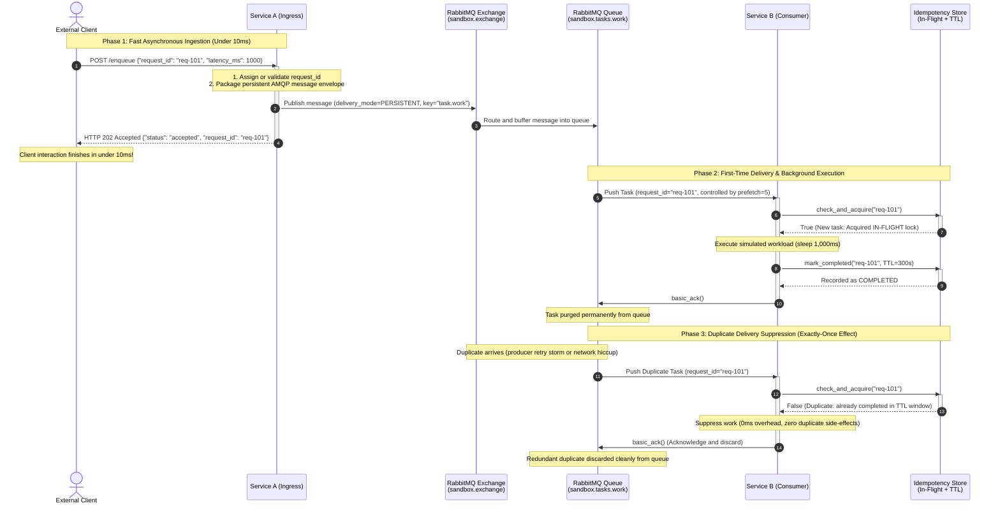

# Step 4 & 5 Q&A Record: Consumer Mechanics, Backpressure & Idempotency

This document records the exact questions, user answers, and detailed explanations exchanged during **Step 4 (Consumer & Backpressure)** and **Step 5 (Idempotency & Deduplication)** of Milestone 3.

---

## 1. Step 4: Consumer & Backpressure Questions & Answers

### Question 1: Prefetch Count & Concurrency
**Prompt:**
* Service B's configuration specifies `rabbitmq_prefetch_count = 5`.
* If Service A dumps 100 messages into RabbitMQ in 1 millisecond, how many messages will RabbitMQ push to Service B at once? What happens to the remaining 95 messages?

**User Answer:**
> rabbitmq will only push 5 message/time, i dont know what unit of time is used on this scenaraio (second, mili-second, etc) and the rest of the message will stay in queue

**Explanation & Verification:**
* **Prefetch is NOT a Rate Limit:** Prefetch is **not** messages-per-second or any time-based metric.
* **Prefetch is a Concurrency Window (In-Flight Capacity Limit):** It tells RabbitMQ: *"Never have more than N unacknowledged messages in transit or processing on this consumer at any given moment."*
* **Load Leveling in Action:** RabbitMQ pushes exactly 5 messages across the TCP socket to Service B. RabbitMQ then pauses. The remaining 95 messages wait securely inside RabbitMQ's queue buffer without consuming any RAM on Service B. The instant Service B finishes Task #1 and calls `basic_ack()`, in-flight count drops to 4, and RabbitMQ immediately pushes Task #6.

---

### Question 2: Where Does a Consumer Run in FastAPI?
**Prompt:**
* Service B is a FastAPI web service running with Uvicorn, not a standalone CLI script.
* Where inside a FastAPI application should the background message consumption loop run so it starts when the server starts and shuts down cleanly without blocking HTTP health checks?

**User Answer:**
> it should run inside the service B lifespan

**Explanation & Verification:**
* **100% Correct:** FastAPI's `@asynccontextmanager async def lifespan(app: FastAPI)` is the modern standard.
* Running `await consumer.start()` inside `lifespan` binds the consumer to the server's lifecycle:
  * On startup: The consumer connects and registers `queue.consume()` as a concurrent background task on Python's `asyncio` event loop.
  * During execution: The consumer processes messages in the background while FastAPI continues answering HTTP requests (`GET /health`, `GET /consumer/stats`) without blocking.
  * On shutdown (`yield` exit): The consumer cleanly cancels its consumer tag and closes channels and connections.

---

### Question 3: When to Send Message Acknowledgments (ACK)?
**Prompt:**
* Should Service B send `basic_ack()` immediately as soon as it receives the message from the queue, or only AFTER it finishes `await asyncio.sleep(...)`? What happens if the worker process crashes midway through the simulated work in both cases?

**User Answer:**
> only after the message is successfully processed

**Explanation & Verification:**
* **100% Correct:**
  * If you ACK upon receipt (**Auto-ACK / At-Most-Once**): RabbitMQ deletes the message immediately. If the worker crashes or runs out of memory midway through processing, the message is permanently lost.
  * If you ACK **after** work completion (**Manual ACK / At-Least-Once**): If the worker crashes during processing, the TCP socket abruptly closes. RabbitMQ detects the disconnection and automatically returns the unacknowledged message to the queue head so another healthy worker can process it.

---

## 2. Step 5: Idempotency & Deduplication Questions & Answers

### Question 1: ACK vs. NACK on Duplicate Messages
**Prompt:**
* Suppose Service B receives a task with `request_id = "order-999"`. It checks its deduplication store and realizes: *"Wait! I already completed `order-999` 10 seconds ago!"*
* What should Service B do with this duplicate message? Should it call `basic_ack()` or `basic_nack()`?
* What would happen to the queue if Service B called `nack(requeue=True)` or threw an exception?

**User Answer:**
> - service B should call basic_nack(requeue=False)
> - the message queue would send the message to service B again

**Explanation & Verification:**
* **Part 2 (Requeueing Duplicates): Correct:** Calling `basic_nack(requeue=True)` on a duplicate puts it back at the front of the queue, causing an immediate redelivery and a 100% CPU infinite crash loop.
* **Part 1 (The Pitfall of `basic_nack(requeue=False)` for Duplicates):**  
  Because the queue is configured with `x-dead-letter-exchange: sandbox.dlx`, calling `nack(requeue=False)` tells RabbitMQ: *"This message is a broken poison pill; send it to the Dead Letter Queue (`sandbox.tasks.dlq`)!"*  
  If duplicates are NACKed, every duplicate pollutes the DLQ and triggers false-alarm operational alerts, even though the task already succeeded previously!
* **The Correct Action: `basic_ack()` (Acknowledge & Discard):**  
  Service B should **skip** the workload simulation (0ms overhead) and call **`basic_ack()`**. This tells RabbitMQ: *"The business requirement for this task has already been satisfied. Safely delete this redundant delivery from the queue."*

---

### Question 2: Memory Management & Deduplication Retention
**Prompt:**
* If Service B stores seen `request_id`s in memory, should it keep those IDs forever in an ever-growing Python `set`? What happens to the server's RAM over 6 months of processing 100,000 tasks per day?
* How should we manage the lifecycle of processed IDs?

**User Answer:**
> - i dont know the actual answer but i think there should be a way to synchronize the message in the queue and in the service B memory so service B didnt have to store all of the completed message
> - just like what i answer above

**Explanation & Verification:**
* **Why RabbitMQ Cannot Synchronize with Service B's Memory:**  
  RabbitMQ purges a message from broker memory the very millisecond it receives the first `ACK`. Once purged, RabbitMQ has zero historical memory that the message ever existed. If a duplicate packet arrives 5 seconds later (e.g. from upstream retry), RabbitMQ treats it as a brand-new message. Therefore, consumer services must defend themselves.
* **The Sliding Window Solution (TTL / LRU):**  
  Service B does not need to store IDs forever. In distributed networks, 99.9% of duplicates arrive within seconds or minutes (TCP reconnections, client retries, retry storms).  
  By using a **Time-To-Live (TTL)** (e.g. 5–60 minutes) or an **LRU (Least Recently Used)** cache capped at e.g. 10,000 IDs, expired IDs automatically evaporate from memory. This guarantees constant, flat RAM usage over months of continuous execution.

---

### Question 3: When to Record the Deduplication Record (Before vs. After Work)
**Prompt:**
* In a real transaction, should you record the `request_id` in your deduplication cache BEFORE running the workload, or AFTER running the workload?
* Consider what happens if the worker server crashes midway through the task in both scenarios.

**User Answer:**
> - after running the work
> - if the worker crash then the queue didnt receive the ack so the message should resend back to the queue

**Explanation & Verification:**
The answer identifies the core trade-off between **Data Loss (Under-processing)** and **Duplicate Execution (Over-processing)**:

1. **If Recorded BEFORE Work Starts:**
   * Worker records ID in cache $\rightarrow$ Begins charging credit card $\rightarrow$ Power cut/crash!
   * RabbitMQ redelivers task to Worker 2 $\rightarrow$ Worker 2 checks cache: *"Already seen!"* $\rightarrow$ Skips and ACKs.
   * **Outcome: Under-processing / Dropped Work.** Customer is never charged, but system records that it was.
2. **If Recorded AFTER Work Completes (User's choice):**
   * Worker charges credit card $\rightarrow$ Crashes before writing ID to cache.
   * RabbitMQ redelivers task to Worker 2 $\rightarrow$ Worker 2 checks cache: Not found $\rightarrow$ Charges card again!
   * **Outcome: Over-processing / Duplicate Side-Effect.**
3. **The Industry Production Standard (Atomic Transaction / Two-Phase):**
   * In non-transactional memory systems, recording *after* work is standard because re-executing is generally preferred over silently losing data.
   * In transactional financial systems (e.g. Postgres), the business mutation and the idempotency record are executed within the **exact same ACID database transaction**:
     ```sql
     INSERT INTO idempotency_records (request_id) VALUES ('order-123');
     UPDATE accounts SET balance = balance - 50;
     -- If the worker crashes anywhere, the entire transaction rolls back!
     ```

---

## 3. End-to-End Sequence Diagram (Step 5 State)

This diagram visualizes the complete lifecycle of a request entering Service A and progressing through RabbitMQ, the backpressure queue, and Service B's in-flight locking and TTL deduplication:



