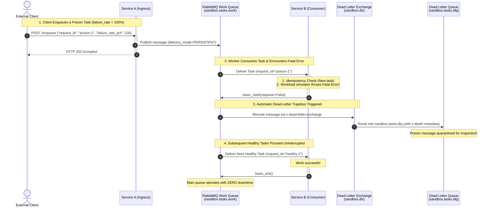

# Step 6 Q&A Record: Poison Messages & Dead Letter Quarantine (DLQ)

This document records the questions, user answers, and detailed explanations exchanged during **Step 6 (Poison Messages & Dead Letter Quarantine)** of Milestone 3.

---

## 1. Step 6 Questions & Answers

### Question 1: The Infinite Crash Loop of `requeue=True`
**Prompt:**
* Suppose Service B pulls a task whose payload has a syntax error or a 100% simulated crash.
* If Service B's code catches the error and executes `await message.nack(requeue=True)`, what will RabbitMQ do?
* What happens to the worker's CPU and memory when there are 1,000 bad messages in the queue with `requeue=True`?

**User Answer:**
> the service will stuck on a infinite loop

**Explanation & Verification:**
* **100% Correct:** In RabbitMQ, calling `requeue=True` returns the rejected message to the **head (front)** of the queue.
* The worker crashes $\rightarrow$ requeues the task $\rightarrow$ immediately receives the exact same unprocessable task 1 millisecond later $\rightarrow$ crashes again.
* With hundreds of poison messages in a queue, worker CPU spikes to **100%**, channel churn escalates, and healthy tasks queued behind the poison pills are completely blocked (**Head-of-Line Blocking**).

---

### Question 2: Triggering Dead Lettering
**Prompt:**
* In Step 2, `sandbox.tasks.work` was declared with:
  ```python
  arguments={"x-dead-letter-exchange": "sandbox.dlx"}
  ```
* What specific Python method and argument must Service B call on the message to trigger RabbitMQ's automatic routing into `sandbox.dlx`?

**User Answer:**
> await message.nack(requeu=False)

**Explanation & Verification:**
* **100% Correct:** Calling `await message.nack(requeue=False)` tells RabbitMQ: *"This task failed and must not be requeued."*
* Because the queue has the `x-dead-letter-exchange` argument, RabbitMQ intercepts the rejected message, attaches an `x-death` metadata array (containing failure timestamp, reason, and original queue name), and publishes it directly into `sandbox.dlx`, which routes it into `sandbox.tasks.dlq`.

---

### Question 3: Non-Blocking Isolation & Production Remediation
**Prompt:**
* When a poison message gets sent to the Dead Letter Queue (`sandbox.tasks.dlq`), does it block or delay healthy tasks that arrive behind it in `sandbox.tasks.work`?
* How does an engineering team typically monitor and fix messages sitting in a DLQ in production?

**User Answer:**
> it will not block the tasks behind it since all of the poisonous message would be sent to the dlq and the queue would instantly send the next message. the engineer have to monitor and fix the worker/publisher since the message is sent by service A so if there are any error, it must be caused by the engineer team, not from end user/client

**Explanation & Verification:**
* **Isolation (Correct):** Once a message is routed to the DLQ, it is completely removed from `sandbox.tasks.work`. Healthy messages proceed at full speed without delay.
* **Root Causes of Poison Messages:** While software bugs in worker code are a primary cause, poison messages frequently arise from:
  1. **Corrupted or Malformed Data:** Payloads that passed simple schema validation but violate business logic.
  2. **Downstream API Outages:** External third-party payment gateways (e.g. Stripe) returning persistent 400/500 errors.
  3. **Data Inconsistencies:** Race conditions where an entity referenced in the payload was deleted before the background task processed.
* **The 4-Step Production Remediation Lifecycle:**
  1. **Alerting:** Real-time metrics alarm when `sandbox.tasks.dlq.message_count > 0`.
  2. **Inspection:** Engineers query the DLQ or use the RabbitMQ Management UI to inspect the quarantined payload and error stack traces.
  3. **Patching:** Fix the software bug in the worker or wait for external service recovery.
  4. **Redrive / Replay:** Use RabbitMQ's **Shovel Plugin** or a replay script to route messages from `sandbox.tasks.dlq` back into `sandbox.exchange` for safe reprocessing.

---

## 2. Poison Message Quarantine Sequence Diagram


