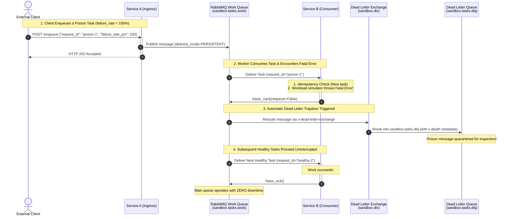
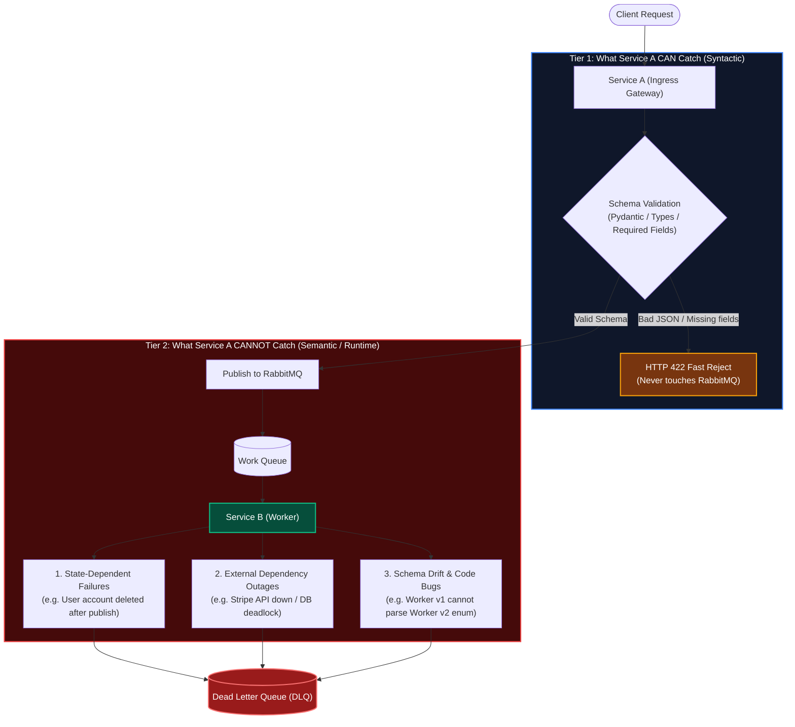

# Step 6 Q&A Record: Poison Messages & Dead Letter Quarantine (DLQ)

This document records the questions, user answers, and detailed explanations exchanged during **Step 6 (Poison Messages & Dead Letter Quarantine)** of Milestone 3.

---

## 1. Step 6 Questions & Answers

### Question 1: The Infinite Crash Loop of `requeue=True`
**Prompt:**
* Suppose Service B pulls a task whose payload has a syntax error or a 100% simulated crash.
* If Service B's code catches the error and executes `await message.nack(requeue=True)`, what will RabbitMQ do?
* What happens to the worker's CPU and memory when there are 1,000 bad messages in the queue with `requeue=True`?

**User Answer:**
> the service will stuck on a infinite loop

**Explanation & Verification:**
* **100% Correct:** In RabbitMQ, calling `requeue=True` returns the rejected message to the **head (front)** of the queue.
* The worker crashes $\rightarrow$ requeues the task $\rightarrow$ immediately receives the exact same unprocessable task 1 millisecond later $\rightarrow$ crashes again.
* With hundreds of poison messages in a queue, worker CPU spikes to **100%**, channel churn escalates, and healthy tasks queued behind the poison pills are completely blocked (**Head-of-Line Blocking**).

---

### Question 2: Triggering Dead Lettering
**Prompt:**
* In Step 2, `sandbox.tasks.work` was declared with:
  ```python
  arguments={"x-dead-letter-exchange": "sandbox.dlx"}
  ```
* What specific Python method and argument must Service B call on the message to trigger RabbitMQ's automatic routing into `sandbox.dlx`?

**User Answer:**
> await message.nack(requeu=False)

**Explanation & Verification:**
* **100% Correct:** Calling `await message.nack(requeue=False)` tells RabbitMQ: *"This task failed and must not be requeued."*
* Because the queue has the `x-dead-letter-exchange` argument, RabbitMQ intercepts the rejected message, attaches an `x-death` metadata array (containing failure timestamp, reason, and original queue name), and publishes it directly into `sandbox.dlx`, which routes it into `sandbox.tasks.dlq`.

---

### Question 3: Non-Blocking Isolation & Production Remediation
**Prompt:**
* When a poison message gets sent to the Dead Letter Queue (`sandbox.tasks.dlq`), does it block or delay healthy tasks that arrive behind it in `sandbox.tasks.work`?
* How does an engineering team typically monitor and fix messages sitting in a DLQ in production?

**User Answer:**
> it will not block the tasks behind it since all of the poisonous message would be sent to the dlq and the queue would instantly send the next message. the engineer have to monitor and fix the worker/publisher since the message is sent by service A so if there are any error, it must be caused by the engineer team, not from end user/client

**Explanation & Verification:**
* **Isolation (Correct):** Once a message is routed to the DLQ, it is completely removed from `sandbox.tasks.work`. Healthy messages proceed at full speed without delay.
* **Root Causes of Poison Messages:** While software bugs in worker code are a primary cause, poison messages frequently arise from:
  1. **Corrupted or Malformed Data:** Payloads that passed simple schema validation but violate business logic.
  2. **Downstream API Outages:** External third-party payment gateways (e.g. Stripe) returning persistent 400/500 errors.
  3. **Data Inconsistencies:** Race conditions where an entity referenced in the payload was deleted before the background task processed.
* **The 4-Step Production Remediation Lifecycle:**
  1. **Alerting:** Real-time metrics alarm when `sandbox.tasks.dlq.message_count > 0`.
  2. **Inspection:** Engineers query the DLQ or use the RabbitMQ Management UI to inspect the quarantined payload and error stack traces.
  3. **Patching:** Fix the software bug in the worker or wait for external service recovery.
  4. **Redrive / Replay:** Use RabbitMQ's **Shovel Plugin** or a replay script to route messages from `sandbox.tasks.dlq` back into `sandbox.exchange` for safe reprocessing.

---

## 2. Poison Message Quarantine Sequence Diagram



---

## 3. Follow-Up: Why Doesn't Service A Prevent Poison Messages Upfront?

### User Question:
> since the initial request is from client and the one who sent the message is service A, shouldnt service A is responsible for parsing the message before sent it to the message broker? or there are some cases that can be handled and cant be handled by service A, if so please tell me

### Detailed Explanation:

Service A **does** validate incoming data, but in distributed microservices, failures are split across two completely different tiers: **Syntactic Validation** versus **Semantic / Runtime Execution**.



---

### What Service A CAN Handle (Syntactic Validation)
Service A inspects the **structural syntax** using Pydantic (`EnqueueRequest`):
* Is the request valid JSON?
* Are required fields present (`request_id`, `latency_ms`)?
* Are the data types correct (integers, strings)?
* Are numbers within allowed ranges (`0 <= failure_rate_pct <= 100`)?

If any of these fail, Service A immediately responds with **`HTTP 422 Unprocessable Entity`**. The message is **never published to RabbitMQ**, so no poison message is ever created for syntax errors.

---

### What Service A CANNOT Handle (Why Poison Messages Still Happen)

Four real-world operational realities explain why syntactically perfect messages can become poison pills once delivered to Service B:

#### 1. Temporal State Changes (Data Changed After Ingestion)
* **Scenario:** Client requests: `{"order_id": "123", "action": "charge_customer"}`.
* When Service A inspects it, `order_id="123"` is valid syntax. Service A enqueues it.
* While the message waits in the queue buffer, the customer cancels their account or order on their mobile phone, deleting the record from the database.
* When Service B pulls the task, `order_id="123"` does not exist. Service B crashes with an unhandled `OrderNotFoundError`.
* **Why Service A could not prevent it:** Service A cannot predict state mutations that occur after publication.

#### 2. Downstream & Third-Party Outages
* **Scenario:** Service B charges a credit card via Stripe or sends an SMS via Twilio.
* The client's payload is valid.
* When Service B executes, the external API returns `HTTP 402 Card Expired` or `HTTP 503 Provider Down`.
* Service A cannot know whether Stripe will accept a credit card without making a synchronous network call to Stripe—which would defeat the entire purpose of an asynchronous queue.

#### 3. Database Isolation & Microservice Decoupling
* In microservices, **Service A does not have access to Service B's private database**.
* If Service A had to query Service B's database to verify every business rule before enqueuing, Service A and Service B would be **tightly coupled**. An outage in Service B's database would bring down Service A's ingestion API.
* Service A's architectural role is to serve as a **lightweight, fast ingestion gateway**.

#### 4. Schema Drift & Asynchronous Deployments
* Service A and Service B are deployed independently in CI/CD.
* Suppose Service A adds a new status enum value `STATUS_PENDING_REVIEW` and publishes it.
* Service B's container has not finished updating yet.
* When Service B reads the message, its Python code crashes with:  
  `ValueError: 'STATUS_PENDING_REVIEW' is not a valid OrderStatus`.
* Every message with that new status is a fatal poison pill to Service B until Service B is updated.

---

### Summary of Validation Responsibilities

| Validation Level | Responsible Service | Example | Result on Failure |
| :--- | :--- | :--- | :--- |
| **Syntactic (Form)** | **Service A** | Missing fields, non-integer types, malformed JSON. | **HTTP 422** to client. Never touches RabbitMQ. |
| **Semantic (Business Logic)** | **Service B** | Account frozen, order cancelled, insufficient balance. | Service B catches and handles business error. |
| **Fatal / Unrecoverable** | **Service B $\rightarrow$ DLQ** | Code bugs, unhandled exceptions, downstream 3rd-party failures, simulated crash injection. | **NACK `requeue=False` $\rightarrow$ Dead Letter Queue**. |

