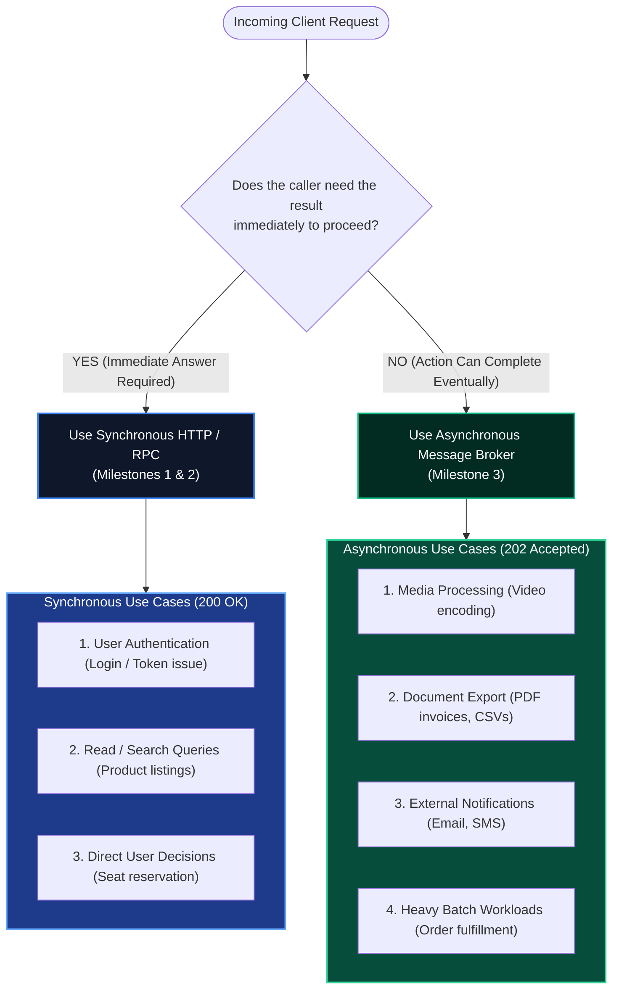

# Step 7 Q&A Record: Verification Methodology & Sync vs. Async Trade-Offs

This document records the questions, user answers, and detailed explanations exchanged during **Step 7 (Verification & Trade-Offs)** of Milestone 3.

---

## 1. Step 7 Questions & Answers

### Question 1: Throughput vs. Latency Curves
**Prompt:**
* In Milestone 1 (synchronous HTTP), sending a burst of 50 requests where each request took 2 seconds of work meant the client had to wait 2 seconds (or crash if concurrency was too high).
* In Milestone 3 (asynchronous), when a client sends 50 requests to `POST /enqueue`, what does the client's perceived latency look like? How does that compare to Milestone 1?

**User Answer:**
> in milestone 3, each request only took about under 10ms from the client pov since all of the request is process asynchronously by the server. but i have a follow-up question for this one. since the message is processed async, the client wont get to know if their request is successfull (200). so are there any cases where its better to process the request in sync so the client get to know the state of their request

**Explanation & Verification:**
* **Client Latency Shift:** In Milestone 1, the client was temporally coupled to worker speed ($R_{latency} \ge W_{work} = 2,000\text{ms}$). In Milestone 3, Service A merely validates JSON syntax and flushes a message frame into the local TCP buffer before returning `HTTP 202 Accepted` ($R_{latency} \approx 5\text{ms} - 10\text{ms}$).
* **Perceived Latency Gain:** Client perceived latency improves by over **99%**, and client connections do not sit idle tying up server threads.

---

### Follow-Up: When Should You Prefer Synchronous (200 OK) Over Asynchronous?
**User Question:**
> are there any cases where its better to process the request in sync so the client get to know the state of their request?

**Explanation & Architectural Decision Criteria:**

#### When Synchronous is Mandatory:
1. **Authentication:** When logging in, the client must receive the session token or JWT before it can render private views.
2. **Read / Query APIs:** Search engines and database queries cannot be deferred; the user expects the results on-screen immediately.
3. **Immediate Decision Dependencies:** Checking ticket availability before advancing to payment checkout.

#### How Asynchronous Systems Notify Clients of Completion:
When tasks run asynchronously, systems bridge the gap using one of three patterns:
1. **Client Polling (`GET /tasks/{id}`):** The client periodically checks task status until it transitions from `PENDING` $\rightarrow$ `COMPLETED`.
2. **WebSockets / Server-Sent Events (SSE):** The server pushes a notification over an open duplex socket when background work finishes.
3. **Webhooks:** In B2B APIs (e.g. Stripe, GitHub), the server performs an HTTP POST callback to a URL configured by the client.

---

### Question 2: Verification Endpoint
**Prompt:**
* In Milestone 1 & 2, tests asserted directly on the HTTP response body returned by `POST /trigger`.
* In Milestone 3, `POST /enqueue` only returns `{"status": "accepted"}`. How can an automated test know whether Service B actually finished the work, rejected a duplicate, or dead-lettered a poison message? What endpoint should it query?

**User Answer:**
> using the /consumer/stats endpoint

**Explanation & Verification:**
* **100% Correct:** Because ingestion is decoupled from consumption, tests query:
  * `GET /consumer/stats`: Exposes `total_completed`, `total_duplicates_skipped`, `total_failed`, and `active_in_flight`.
  * `GET /consumer/dlq`: Exposes live quarantined message counts in `sandbox.tasks.dlq`.

---

### Question 3: Test State Cleanliness
**Prompt:**
* Before running an automated test scenario for duplicates or poison pills, why is it critical that our test suite purges the queues and clears the deduplication store? What could happen if old messages from a previous test run were left in the queue?

**User Answer:**
> because it could lead to data inaccuracy

**Explanation & Verification:**
* **100% Correct:** Lingering state triggers cross-test pollution:
  * Old unacknowledged messages will be consumed during subsequent tests, skewing assertion counters (`total_completed`).
  * Residual request IDs stored in the `IdempotencyStore` will cause fresh test requests to be falsely identified as duplicates and skipped.
* **The Solution:** Every test scenario must execute a pre-test teardown:
  1. Purge `sandbox.tasks.work`.
  2. Purge `sandbox.tasks.dlq`.
  3. Clear Service B's in-memory `IdempotencyStore`.
