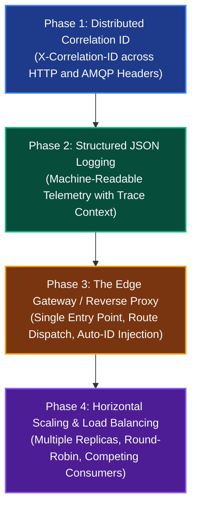

# Milestone 4 Implementation Plan: Concept-First Step-by-Step Roadmap

Welcome to the hands-on roadmap for **Milestone 4: Scaling, Routing & Observability**.

To ensure deep understanding and avoid cognitive overload, this milestone is structured **concept-first**: each phase introduces exactly one idea and one technical mechanism, keeping external infrastructure minimal until the core concepts are proven.

---

## 🗺️ The 4 Concept-First Phases

---

## 📋 Phase Breakdown

### Phase 1: Distributed Correlation ID (The "FedEx Tracking Number")
* **The Problem:** In a distributed system, a single user click triggers calls across Service A, RabbitMQ, and Service B. When an error occurs 3 hops downstream, plain logs do not tell you which incoming request caused the crash.
* **The Concept:** Generate or accept a unique identifier (`X-Correlation-ID`) at the service perimeter, and propagate it across both HTTP headers and AMQP message headers.
* **Key Implementation:**
  * FastAPI middleware on Service A and Service B that captures `X-Correlation-ID` or generates a new UUIDv4 if missing.
  * Injects `X-Correlation-ID` into outgoing HTTP response headers so callers can correlate their request.
  * Passes `correlation_id` into `aio_pika.Message(headers={"correlation_id": ...})` when publishing to RabbitMQ.
  * Service B consumer extracts `correlation_id` from message headers and binds it to the processing task context.
* **Technology:** Pure Python (FastAPI Middleware, `contextvars`, `aio-pika`). Zero new infrastructure containers required.

---

### Phase 2: Structured JSON Logging (Machine-Readable Telemetry)
* **The Problem:** Free-text log lines (e.g., `logger.info("Task completed")`) cannot be parsed, filtered, or searched reliably by log aggregation tools (Elasticsearch, Loki, Datadog) once multiple services output to stdout simultaneously.
* **The Concept:** Standardize all service log output into machine-readable JSON lines containing timestamp, log level, service name, message, and the active `correlation_id` from Phase 1.
* **Key Implementation:**
  * Custom `JSONFormatter` in Python's standard `logging` library.
  * Contextual log propagation using Python `contextvars` so every log emitted within an async request/consumer automatically includes the active `correlation_id`.
* **Technology:** Pure Python standard library (`logging`, `json`, `contextvars`).

---

### Phase 3: The Edge Gateway / Reverse Proxy (The "Front Door Receptionist")
* **The Problem:** Direct external access to internal microservice ports (`:8000`, `:8001`) creates security risks, tight coupling, and prevents zero-downtime routing changes.
* **The Concept:** Deploy a single Edge Reverse Proxy (e.g., Nginx or Traefik) on port `80`/`8080` as the exclusive public ingress.
* **Key Implementation:**
  * Proxy routes path prefixes (`/api/v1/trigger` $\rightarrow$ Service A, `/api/v1/enqueue` $\rightarrow$ Service A, `/api/v1/work` $\rightarrow$ Service B).
  * Gateway automatically injects an `X-Correlation-ID` header if the client omitted it, ensuring 100% of internal traffic is pre-tagged.
  * Blocks external access to internal-only endpoints.
* **Technology:** Lightweight Edge Proxy container in `docker-compose.yml`.

---

### Phase 4: Horizontal Scaling & Load Distribution ("More Cashiers")
* **The Problem:** A single instance of Service B or Service A creates a processing bottleneck and a single point of failure.
* **The Concept:** Run multiple identical replicas of Service A and Service B simultaneously (`docker compose up --scale service-b=3`).
* **Key Implementation:**
  * Edge Gateway balances incoming HTTP traffic across Service A replicas using Round-Robin.
  * RabbitMQ distributes queued tasks across competing Service B consumer instances naturally via AMQP round-robin delivery.
  * Verification that load is evenly divided and requests are processed concurrently.
* **Technology:** Docker Compose `--scale`, Gateway upstream load balancing pools, RabbitMQ competing consumers.

---

## 🛑 Operational Rules & Methodology

1. **Phase-by-Phase Execution:** We execute **one phase at a time**.
2. **Explicit Stop After Each Phase:** When a phase is complete, we verify it, commit it, and stop. We do not proceed to the next phase without explicit confirmation.
3. **Inquiry Before Code:** Before writing code for any phase, we discuss the architectural concepts, trade-offs, and design options first.
4. **Permanent Q&A Records:** Every architectural discussion and design decision is saved in dedicated Markdown files under `docs/milestone-4/`.
