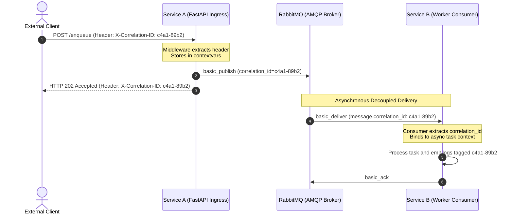

# Phase 1 Inquiry: Distributed Correlation ID & End-to-End Tracing

This document records the foundational inquiry and architectural design decisions for **Milestone 4, Phase 1: Distributed Correlation ID**.

---

## 💡 The Problem Space

In a microservices architecture, a single user transaction often crosses multiple physical boundaries:
1. External client sends an HTTP request to an ingress service (Service A).
2. Service A performs internal processing, executes retries if transient errors occur, and dispatches tasks to an asynchronous message broker (RabbitMQ).
3. One or more worker instances (Service B) pull the task, execute downstream logic, update state, and potentially report to a Dead Letter Queue if processing fails.

When an error or latency anomaly occurs three hops downstream, plain logs do not reveal which initial user request initiated that execution. Without an end-to-end tracing identifier, debugging a distributed system becomes an exercise in guessing timestamps across unsynchronized machine clocks.

---

## ❓ Architectural Inquiry & Reasoning

### Question 1: Request ID vs. Correlation ID
> **Question:**  
> In Milestones 1, 2, and 3, we already had a field called `request_id` inside our JSON payloads (e.g. `{"request_id": "task-123"}`). Why isn't having a `request_id` inside the JSON body enough for distributed tracing? What is the difference between an application's `request_id` (Task ID) and an infrastructure `Correlation-ID` (Trace ID)?

#### Candidate Answer:
> *"Because `request_id` is isolated in each service, we don't have a global ID that is always attached to every request from end to end."*

#### Architectural Evaluation & Epistemic Candor:
* **Core Insight:** Correct. The fundamental difference lies in **scope and causality**.
* **`request_id` (Task / Idempotency Key):** Represents a specific, bounded unit of work. In Milestone 3, `request_id` served as the deduplication key to guarantee the Exactly-Once processing effect.
* **`correlation_id` (Trace ID):** Represents the **entire causal tree** of actions initiated by an external event.
* **The Retry Distinction:**
  * If a client request triggers a call from Service A to Service B, and Service A encounters network timeouts, Service A may execute 3 retries.
  * Each retry attempt represents a distinct network transmission.
  * However, **all 3 retries share the exact same `correlation_id`**.
  * When an operator queries logs for that single `correlation_id`, they see the complete causal history: the initial failure, the subsequent backoffs, and the final resolution.

---

### Question 2: In-Payload JSON vs. Message Envelope Metadata
> **Question:**  
> When Service A receives an HTTP request and publishes a task to RabbitMQ, where should this `correlation_id` be placed? Should it be embedded inside the task's JSON body (`body = {"correlation_id": ...}`), or should it live somewhere else in the AMQP message envelope? Why?

#### Candidate Answer:
> *"It should be embedded inside the task JSON so we can map each HTTP request to its RabbitMQ message."*

#### Architectural Challenge & Correction:
Embedding infrastructure tracing identifiers inside application JSON bodies is a classic anti-pattern for three critical reasons:

1. **Protocol Consistency Across HTTP and AMQP:**
   * In HTTP, distributed tracing headers (`X-Correlation-ID`, `traceparent`) live in the **HTTP headers**, not the JSON body.
   * HTTP `GET` and `DELETE` requests do not even possess a body.
   * Storing tracing metadata in headers allows reverse proxies, API gateways, and load balancers to read and log the trace ID in microseconds without needing to buffer and parse JSON payloads.
2. **Native AMQP Envelope Properties:**
   * AMQP 0-9-1 explicitly provides first-class metadata properties in the message envelope:
     * `correlation_id`: Native AMQP string attribute on the envelope.
     * `headers`: Key-value table for custom metadata (`x-correlation-id`).
   * When `aio_pika.Message(correlation_id=..., headers=...)` is published, the broker stores and routes these metadata fields independently of the raw binary payload (`body`).
3. **Payload Format Agnosticism & DLQ Triage:**
   * Messages in production may carry binary Protobuf, compressed gzip archives, images, or CSV data rather than JSON. If tracing required JSON deserialization, non-JSON streams could not be traced.
   * In Dead Letter Queue (DLQ) inspection, an operator or automated monitoring tool can inspect `message.correlation_id` directly off the envelope without parsing or deserializing untrusted or corrupted poison payloads.

---

## 📐 End-to-End Correlation Lifecycle Diagram

The following sequence details how the `X-Correlation-ID` originates, travels across network protocols, and binds to execution contexts:

---

## 🛠️ Phase 1 Technical Specification

1. **Context Management (`correlation.py`):**
   * Use Python's standard `contextvars.ContextVar` to hold `correlation_id` across asynchronous coroutines without thread or task interference.
   * Provide safe helper functions: `get_correlation_id()` and `set_correlation_id()`.
2. **FastAPI Middleware (`middleware.py`):**
   * Inspect incoming HTTP headers for `X-Correlation-ID`.
   * If missing, generate a new UUIDv4 string.
   * Bind the ID to `contextvars` for the lifetime of the request.
   * Attach `X-Correlation-ID` to the outgoing HTTP response header.
3. **HTTP Client Forwarding:**
   * In Service A's synchronous call to Service B, propagate `X-Correlation-ID` in the outgoing `httpx.AsyncClient` request headers.
4. **AMQP Envelope Integration:**
   * In Service A's `publisher.py`, pass `correlation_id` and `headers={"x-correlation-id": ...}` into `aio_pika.Message`.
   * In Service B's `consumer.py`, extract `message.correlation_id` (or fallback to envelope headers) upon receipt and set it in context before task processing.
