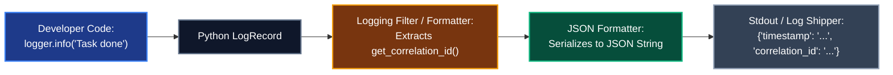

# Phase 2 Inquiry: Structured JSON Logging & Machine-Readable Telemetry

This document records the foundational inquiry and architectural decisions for **Milestone 4, Phase 2: Centralized Structured JSON Logging**.

---

## 💡 The Problem Space

In a single-instance monolith, developers frequently write logs as free-form human text:
```text
2026-11-06 12:00:00 [INFO] Task completed in 45ms for request id=123
```

However, when scaling out to 10 or 100 concurrent microservice containers emitting logs simultaneously to stdout, free-form text fails catastrophically:
1. **Unparseable Schemas:** If a developer alters the text from `"Task completed in 45ms"` to `"Finished task duration=45ms"`, fragile regular expressions written by operations teams break immediately.
2. **Multi-Line Log Interleaving (The Stack Trace Bug):** When an unhandled exception occurs in Python, a traceback spans 20 separate lines. In a multi-threaded or multi-container environment, stdout lines from different requests interleave. Standard log collectors (Fluentbit, Promtail, Vector) interpret each line as a new independent event, fracturing stack traces across time.
3. **Inability to Perform Metric Queries & Range Filters:** Operations tools cannot compute p99 latency or aggregate error counts over arbitrary text strings without expensive runtime regex parsing.

---

## ❓ Architectural Inquiry & Reasoning

### Question 1: Unstructured Text vs. Structured Key-Value JSON
> **Question:**  
> Why is plain human-readable text considered a dangerous anti-pattern when operating 10 or 100 microservices at scale? What happens when monitoring systems (like Datadog, Elasticsearch, or AWS CloudWatch) try to parse free-form text?

#### Candidate Answer:
> *"Because you can't filter the log, so you have to manually search it in case you need it. With structured JSON logging, you can query specific values by the key."*

#### Architectural Evaluation & Epistemic Candor:
* **Core Insight:** Exactly right. The primary limitation is **queryability and indexing efficiency**.
* **Key-Value Indexing:** In JSON format, every log line is a self-contained, typed dictionary:
  ```json
  {
    "timestamp": "2026-11-06T12:00:00.123Z",
    "level": "INFO",
    "service": "service-b",
    "correlation_id": "c4a1-89b2",
    "message": "Task completed",
    "duration_ms": 45,
    "status": "completed"
  }
  ```
* **Range & Aggregation Queries:** Monitoring systems parse these typed fields automatically upon ingestion. Operators can write precise queries like:
  * `correlation_id: "c4a1-89b2"` (Traces the single transaction across all services in 1 click).
  * `service: "service-b" AND level: "ERROR" AND duration_ms > 500` (Finds slow failures instantly without full-text regex scanning).
* **Atomic Stack Trace Quarantine:** Multi-line exception tracebacks are captured in a single string field (`"exc_info": "Traceback (most recent call last):\n ..."`), guaranteeing that an error remains an atomic, non-interleaved log entry.

---

### Question 2: Transparent Context Injection
> **Question:**  
> When a developer writes `logger.info("Simulated failure occurred")` inside their route handler or consumer loop, they shouldn't have to manually pass `correlation_id=get_correlation_id()` every single time they type a log line.  
> How can our logging system **automatically inject** the active `correlation_id` into every log statement behind the scenes without the developer having to remember to type it?

#### Candidate Answer:
> *"By creating a template/schema for the log."*

#### Architectural Nuance & The Technical Mechanism:
* **The Distinction:** A template or schema defines *what fields exist* in the JSON output, but it does not know *how to fetch the runtime value* of `correlation_id` dynamically on every log call.
* **The Python Logging Pipeline:**
  Python's built-in `logging` module processes log statements in a pipeline:



1. **`LogRecord` Creation:** When `logger.info("msg")` is called, Python packages the call into a `LogRecord` containing basic fields (`name`, `levelname`, `msg`, `pathname`, `lineno`).
2. **Context Enrichment via `logging.Filter`:**
   * A custom `CorrelationIdFilter` intercepts every `LogRecord` before formatting.
   * It calls `get_correlation_id()` (which retrieves the ID bound to the active `contextvars` context in Phase 1).
   * It dynamically attaches `record.correlation_id = get_correlation_id()`.
3. **Serialization via `JSONFormatter`:**
   * A custom `JSONFormatter` extracts the enriched fields and produces a single-line, valid JSON string to `sys.stdout`.
4. **Developer Experience:**
   * Developers write standard, clean Python: `logger.info("Task processed successfully")`.
   * The output is automatically and transparently injected with `"correlation_id": "c4a1-89b2"` and `"service": "service-a"`.

---

## 🛠️ Phase 2 Technical Blueprint

1. **`logging_config.py` in both Service A & Service B:**
   * **`CorrelationIdFilter(logging.Filter)`:** Adds `record.correlation_id = get_correlation_id()` to all emitted `LogRecord`s.
   * **`JSONFormatter(logging.Formatter)`:** Serializes log records into standard JSON with keys:
     * `timestamp`: ISO-8601 UTC string (`datetime.now(UTC).isoformat()`).
     * `level`: Standardized upper-case severity (`INFO`, `WARNING`, `ERROR`).
     * `service`: Name of the service emitting the log (`service-a` or `service-b`).
     * `correlation_id`: Current trace ID or `null`.
     * `message`: Rendered message text.
     * `exc_info`: Formatted stack trace if an exception occurred.
2. **Framework Integration:**
   * Configure root logger and Uvicorn loggers so access logs and application logs follow the identical JSON structure.
