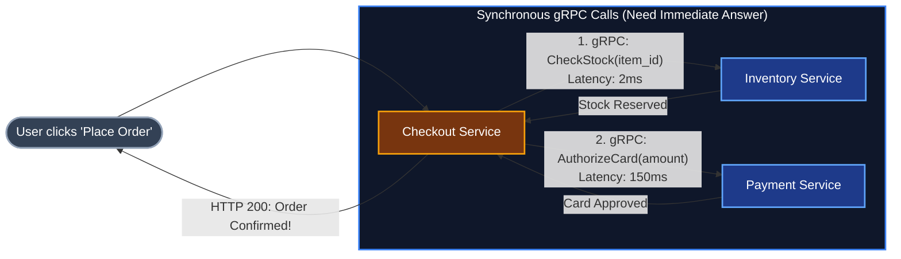
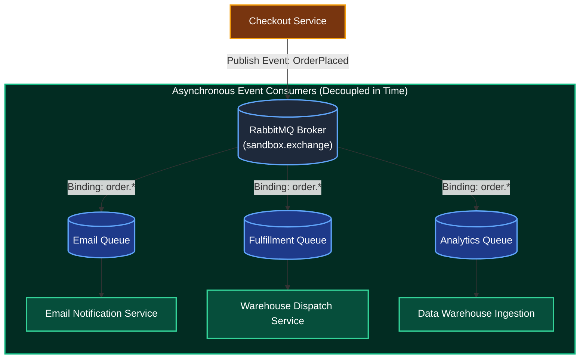
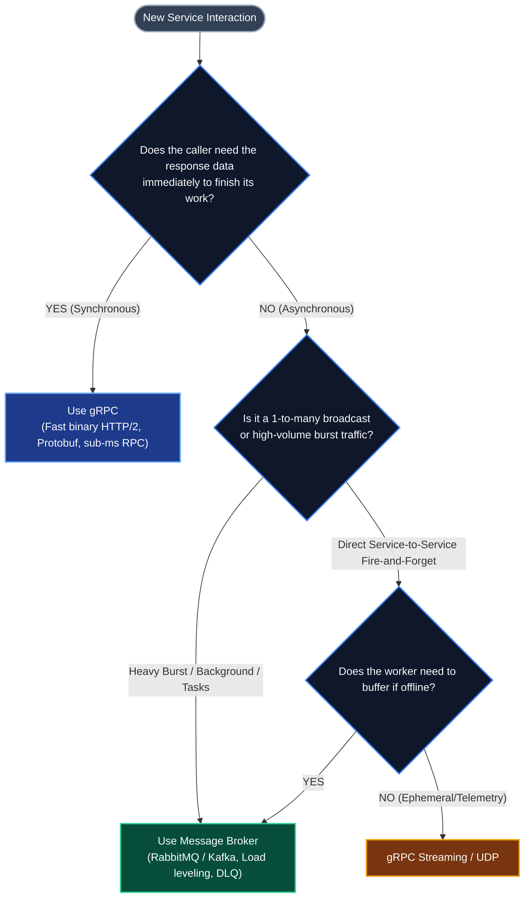

# Architectural Guide: Synchronous gRPC vs. Asynchronous Message Broker

In distributed systems and microservices engineering, one of the most critical architectural decisions is choosing the inter-service communication paradigm: **When should two services communicate synchronously via gRPC, and when should they communicate asynchronously via a Message Broker (such as RabbitMQ or Apache Kafka)?**

This document presents the complete architectural decision framework, comparing both paradigms across technical dimensions, failure modes, real-world industry patterns, and concrete use cases.

---

## 1. The 30-Second Rule of Thumb

* **Use Synchronous gRPC** when the caller **cannot proceed without the answer right now** (blocking reads, real-time validations, transactional pre-checks).
* **Use an Asynchronous Message Broker** when the action **can finish eventually**, when you need to **absorb traffic bursts (load leveling)**, or when **multiple services** need to react to the same event (fanout/pub-sub).

---

## 2. Comprehensive Architectural Comparison Matrix

| Dimension | Synchronous gRPC | Asynchronous Message Broker (RabbitMQ / Kafka) |
| :--- | :--- | :--- |
| **Caller Requirement** | **Blocking / Query:** Needs the result immediately to complete its own execution. | **Fire-and-Forget / Eventual:** Enqueues the task and moves on; result is processed in background. |
| **Temporal Coupling** | **Tightly Coupled:** Both services must be online, reachable, and responsive at the exact same millisecond. | **Decoupled in Time:** Worker can crash, restart 30 minutes later, and process the backlog with zero data loss. |
| **Traffic Bursts** | **Vulnerable to Overload:** 5,000 concurrent RPC calls hit the worker simultaneously. Worker can crash from CPU/memory starvation. | **Protected (Load Leveling):** Queue holds 5,000 tasks; worker pulls at its own controlled concurrency (`prefetch_count=5`). |
| **Communication Topology** | **1-to-1 Point-to-Point:** Caller directly addresses the target service. | **1-to-Many (Pub / Sub):** Publisher emits 1 event; multiple queues (Billing, Email, Audit) receive independent copies. |
| **Failure Blast Radius** | **High:** Slowness in the downstream service cascades directly upstream (**Tail Latency Amplification**). | **Low:** Slowness in downstream services only increases queue backlog; the upstream ingestion API latency is unaffected. |
| **Latency Profile** | **Sub-millisecond to low milliseconds:** Direct binary HTTP/2 transport over internal network. | **5ms to 50ms+:** Incurs intermediate network hop, disk synchronization log, and broker scheduling. |
| **Infrastructure Overhead** | **Zero extra infrastructure:** Direct network sockets between services. | **Requires a broker cluster:** Must operate, monitor, patch, and scale RabbitMQ or Kafka nodes. |

---

## 3. Deep Dive: When to Choose Synchronous gRPC

Choose gRPC for **read operations**, **immediate validations**, and **tightly coordinated internal queries** where a message broker would add unnecessary hop latency.



### Primary gRPC Strengths:
1. **Binary Protobuf Efficiency:** Replaces verbose JSON text with compact, strongly typed binary Protocol Buffers. Typically 5x to 10x smaller payload size and 5x to 8x faster CPU serialization.
2. **HTTP/2 Multiplexing:** Multiple concurrent RPC calls travel across a **single, long-lived TCP socket** broken into binary frames, eliminating connection pool churn.
3. **Strict IDL Contracts:** Service contracts are formally defined in `.proto` files, enabling compile-time type checking and zero manual URL typing.
4. **Native Deadline Propagation:** If the caller aborts or times out after 500ms, an `RST_STREAM` frame travels down the wire to halt downstream execution, preventing wasted CPU on dead requests.

### Real-World gRPC Use Cases:
1. **Real-Time Data Queries (Reads):**
   * *Example:* The API Gateway calls the User Profile Service: *"Fetch username and permissions for `user-123`."*
   * *Why not a broker?* A queue cannot return an answer to a caller on the spot without building complex request-reply temporary return queues (RPC-over-RabbitMQ), which is clunky and slow.
2. **Pre-Condition Checks & Immediate Validations:**
   * *Example:* The Checkout Service calls the Fraud Detection Service: *"Is this transaction high risk?"*
   * *Why not a broker?* If the fraud check fails or is delayed, you cannot allow checkout to succeed. You must block until you get a `PASS` or `REJECT`.
3. **Ultra-Low Latency Internal Pipelines:**
   * *Example:* High-frequency trading, ad bidding, or microservices inside the same Kubernetes cluster requiring sub-millisecond round trips. An intermediate broker adds an unnecessary network hop and disk write.

---

## 4. Deep Dive: When to Choose an Asynchronous Message Broker

Choose a message broker for **background processing**, **external side effects**, **traffic spike absorption**, and **event-driven choreography**.



### Primary Broker Strengths:
1. **Load Leveling (Queue Buffering):** Absorbs massive bursts of incoming traffic. While clients receive immediate `HTTP 202 Accepted` acknowledgments in under 10ms, workers pull tasks at a controlled, sustainable rate (`prefetch_count=5`).
2. **Temporal Decoupling:** The worker node can be down, restarted, or under maintenance for 30 minutes without dropping a single task. The durable queue holds all messages safely on disk.
3. **Fanout Broadcast (Pub/Sub):** A publisher writes an event once to an exchange; the exchange automatically clones copies to multiple independent queues without the publisher knowing who is listening.
4. **Dead Letter Quarantine (DLQ):** Poison pills that crash worker code are isolated into a dedicated queue for inspection without blocking healthy tasks queued behind them.

### Real-World Message Broker Use Cases:
1. **Slow or Resource-Heavy Background Tasks:**
   * *Example:* Video transcoding (YouTube), rendering PDF invoices, compressing archives, generating monthly financial reports.
   * *Why not gRPC?* Holding open an HTTP/2 gRPC connection for 45 seconds while a video converts ties up client sockets and will be severed by cloud load balancer timeouts.
2. **Absorbing Traffic Bursts (Flash Sales / Ticket Drops):**
   * *Example:* 50,000 customers place orders in 10 seconds, but your warehouse database can only write 1,000 orders per second.
   * *With gRPC:* Service A calls Service B 50,000 times; Service B runs out of database connections, crashes from OOM, and cascading failure takes down Service A.
   * *With Broker:* Service A enqueues all 50,000 orders into RabbitMQ in 200ms (`202 Accepted`). Service B drains the queue at a safe, steady 1,000/sec over 50 seconds. Zero crashes.
3. **Event Notification (Pub/Sub):**
   * *Example:* `CustomerRegistered` event. The Loyalty Points service, the Email service, and the Analytics team all need to know.
   * *With gRPC:* The User Service must make 3 separate network calls to 3 different services. If the Loyalty service is down, the registration fails!
   * *With Broker:* The User Service publishes 1 message to the exchange. The broker clones it into 3 queues. The User Service doesn't even know the Loyalty service exists.
4. **Third-Party External Integrations:**
   * *Example:* Sending an SMS via Twilio or a push notification via Apple APNS.
   * *Why not gRPC?* Third-party networks have outages. If Twilio goes down for 20 minutes, messages wait safely in RabbitMQ. When Twilio recovers, the worker resumes sending.

---

## 5. The Real-World Production Pattern: The Hybrid Architecture

In mature companies (Uber, Netflix, Shopify), systems **never choose one exclusively**. They combine both in the same request flow:

```text
                      Customer Clicks "Book Uber"
                                  │
                                  ▼
                        [ Ride Dispatch Service ]
                                  │
         ┌────────────────────────┴────────────────────────┐
         │                                                 │
   (Synchronous gRPC)                               (Asynchronous Broker)
   Must happen NOW:                                 Can happen eventually:
         │                                                 │
         ├─► gRPC: DriverMatchingService                   ├─► RabbitMQ: Send Push Notification
         ├─► gRPC: CalculateSurgePrice                     ├─► RabbitMQ: Record Trip Analytics
         └─► gRPC: PreAuthorizeCreditCard                  └─► RabbitMQ: Audit Logger
```

1. **gRPC** handles the **tight synchronous core**: Can we find a driver? Is the card valid? What is the price? The rider needs this on their phone screen in 1 second.
2. **RabbitMQ / Kafka** handles the **asynchronous ripple effects**: Sending receipt emails, updating driver loyalty points, feeding data science models, and streaming telemetry.

---

## 6. The Decision Flowchart

When designing any new service-to-service interaction, follow this sequential decision tree:


